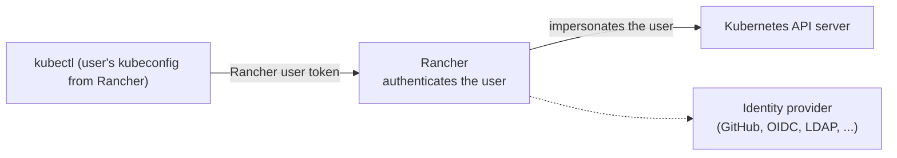

# Dashboard: Headlamp, Kubernetes Dashboard and Rancher
{: .no_toc }

A web UI to browse and operate the cluster. Pick one of three, from a light viewer to a full management platform.
{: .fs-5 .fw-300 }

1. TOC
{:toc}

## Choose a dashboard

| `utilities.dashboard.type` | What you get | Login | Good for |
|----------------------------|--------------|-------|----------|
| `headlamp` (default) | A light, extensible Kubernetes UI (a Kubernetes SIG UI project) | A ServiceAccount token | Day-to-day browsing of a lab cluster |
| `kubernetes-dashboard` | The classic Kubernetes Dashboard | A token for an `admin-user` ServiceAccount | Compatibility with older guides (the upstream project is deprecated: prefer Headlamp) |
| `rancher` | Rancher: cluster management, users, roles, and an **authentication proxy** for `kubectl` | Rancher users (local or from an identity provider) | Several people sharing a cluster with their own logins and permissions |

```yaml
utilities:
  dashboard:
    enable: true
    type: "headlamp"                     # headlamp | kubernetes-dashboard | rancher
    namespace: "kubernetes-dashboard"    # Headlamp and Kubernetes Dashboard (Rancher always uses cattle-system)
    ingressClass: "traefik"
    host: "dashboard.kubewekend.local"
    createAdminToken: true               # print a login token at the end of the install
```

> [!NOTE]
>
> The hostnames in these guides (`*.kubewekend.local`) must resolve to your ingress address, for example with an
> entry in `/etc/hosts`.

## Headlamp and Kubernetes Dashboard

```bash
./scripts/setup.sh k3s utils dashboard
```

The chart is installed in `utilities.dashboard.namespace` with an Ingress on `utilities.dashboard.host`. With
`createAdminToken: true` the end of the Ansible output prints a token:

- **Headlamp:** a token of the chart's `headlamp` ServiceAccount (`kubectl create token -n <namespace> headlamp`).
- **Kubernetes Dashboard:** the playbook creates an `admin-user` ServiceAccount bound to `cluster-admin`, and prints
  its token.

Open the host (`dashboard.kubewekend.local`) in a browser and paste the token. Tokens from `kubectl create token`
expire (one hour by default): create a new one the same way when you need it.

> [!WARNING]
>
> Both tokens carry cluster-admin rights. That is fine for a lab; do not reuse this setup on a shared cluster.

## Rancher

Rancher is a management platform. Installed by Kubewekend into the cluster it manages, it gives you a UI **and** a
single, authenticated door to the cluster's API.

### Requirements

- **cert-manager must be installed first.** Rancher uses it to issue its own TLS certificate. The playbook only installs
  Rancher when `utilities.certmanager.enable` is `true`, and skips it silently otherwise.
- **Resources:** Rancher is much heavier than the other two dashboards; give the node some headroom.

### Install

Install cert-manager and Rancher in one run (tags run in playbook order, so cert-manager comes first):

```bash
./scripts/setup.sh k3s utils certmanager dashboard
```

```yaml
utilities:
  certmanager:
    enable: true
  dashboard:
    enable: true
    type: "rancher"
    ingressClass: "traefik"
    host: "dashboard.kubewekend.local"   # Rancher's hostname
```

Rancher goes into the `cattle-system` namespace (one replica, version 2.13.1). Its certificate is self-signed, so the
browser warns until you trust it.

### First login

Rancher generates a bootstrap password at install time. Read it, open the host, and set a real admin password when
asked:

```bash
kubectl -n cattle-system get secret bootstrap-secret -o jsonpath='{.data.bootstrapPassword}' | base64 -d; echo
```

### Rancher as an authentication proxy for kubectl

Rancher can stand between people and the Kubernetes API:



1. People sign in to Rancher with a Rancher user, or through an identity provider configured in Rancher (GitHub,
   OIDC, LDAP and others).
2. In the UI, each user downloads **their own kubeconfig** for the cluster (the cluster's "Download KubeConfig" action).
   It points at Rancher, not at the API server, and carries that user's Rancher token.
3. Every `kubectl` request goes through Rancher, which checks the token and forwards the request to the API server
   **as that user**, so the Kubernetes RBAC and Rancher roles of that user apply.

You get one place to add and remove people and to give them roles, without creating client certificates or
ServiceAccount tokens per person, and without changing the API server's own authentication flags. Try it: create a
second Rancher user with a read-only role, download their kubeconfig, and check what `kubectl auth can-i` allows.

## Verify

```bash
kubectl -n kubernetes-dashboard get pods,ingress      # Headlamp or Kubernetes Dashboard
kubectl -n cattle-system get pods,ingress             # Rancher
```

The Ingress host is the one from `utilities.dashboard.host`; the Pods must be `Running`.

## Troubleshooting

| Symptom | Cause | Fix |
|---------|-------|-----|
| `type: rancher` but nothing was installed | `utilities.certmanager.enable` is `false` | Turn it on and run `utils certmanager dashboard` |
| The Rancher install fails on certificates | cert-manager is enabled in `master.yaml` but not installed | Run the `certmanager` tag first (or together with `dashboard`) |
| The token is rejected | It expired | Create a new one with `kubectl create token` |
| The host does not open | The name does not resolve to the ingress | Add it to `/etc/hosts`, check `kubectl get ingress -A` |
