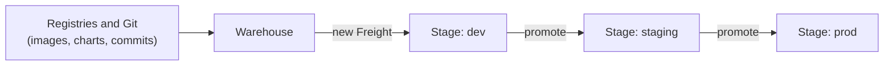

# GitOps: Argo CD, Flux and Kargo
{: .no_toc }

Keep the cluster in sync with Git: you change a repository, a controller in the cluster applies the change. Choose
Argo CD or Flux for the sync, and add Kargo to promote releases from one environment to the next.
{: .fs-5 .fw-300 }

1. TOC
{:toc}

## Choose

| Option | Role | What Kubewekend installs | UI |
|--------|------|-------------------------|----|
| **Argo CD** (`type: argocd`) | Sync engine | Argo CD (Helm chart 10.16.0) in `argocd`, plus optional **Image Updater** and **UI extensions** (metrics, Argo Rollouts) | Argo CD UI at `gitops.argocd.host` |
| **Flux** (`type: flux`) | Sync engine | Flux v2.7.5 controllers in `flux-system` and the `flux` CLI on the node, plus the optional **Weave GitOps** UI | Weave GitOps at `gitops.flux.host` |
| **Kargo** (`kargo.enable`) | Promotion on top of a sync engine | Kargo 1.8.6 in `kargo` | Kargo UI at `gitops.kargo.host` |

Argo CD and Flux are alternatives (`type` picks one). Kargo is not a third sync engine: it decides **which version goes
to which environment** and lets the sync engine apply it. It pairs best with Argo CD.

```yaml
utilities:
  gitops:
    enable: true
    type: "argocd"                # argocd | flux
    argocd:
      host: "argocd.kubewekend.local"
      ingressClass: "traefik"
      argocdImageUpdater: true    # write new image tags back to Git
      argocdExtensions: false     # metrics and Argo Rollouts tabs in the Argo CD UI
    flux:
      ui: true                    # Weave GitOps UI
      host: "flux.kubewekend.local"
      ingressClass: "traefik"
    kargo:
      enable: false               # multi-stage promotion
      ingressClass: "traefik"
      host: "kargo.kubewekend.local"
```

```bash
./scripts/setup.sh k3s utils gitops
```

The hostnames must resolve to your ingress address (for example with `/etc/hosts`).

## Argo CD

- **Ingress:** the UI is published at `gitops.argocd.host`. TLS ends at the ingress, so the Argo CD server runs with
  `server.insecure=true`.
- **No bundled Dex:** single sign-on is off (`dex.enabled=false`); you log in with the built-in `admin` account.
- **Image Updater** (`argocdImageUpdater: true`): watches container registries and updates the image tag of an
  Application when a new version matches your rules.
- **Extensions** (`argocdExtensions: true`): adds a metrics tab (argocd-extension-metrics) and an Argo Rollouts tab
  (rollout-extension) to the Argo CD UI.

First login: user `admin`, and the generated password:

```bash
kubectl -n argocd get secret argocd-initial-admin-secret -o jsonpath='{.data.password}' | base64 -d; echo
```

Change it after the first login. To practise, follow the [Argo CD labs]():
App of Apps and AppProjects, `Application` vs `ApplicationSet`, Image Updater end to end, and managing a second cluster with
argocd-agent.

## Flux

- **Controllers:** Flux's components are applied from the v2.7.5 install manifest into `flux-system`.
- **CLI:** the `flux` command is installed on the node, so you can run `flux check` and `flux get all -A` there.
- **Weave GitOps UI** (`flux.ui: true`): a web UI for Flux at `gitops.flux.host`.

> [!WARNING]
>
> The Weave GitOps admin account is created as user `kubewekend` with password `kubewekend`. Change it before the
> cluster is reachable by anyone else.

## Kargo: promotion between stages

A sync engine keeps an environment equal to Git, but it does not decide **when a new version may move from dev to
staging to production**. Kargo does:



| Kargo concept | Meaning |
|---------------|---------|
| **Warehouse** | Watches sources (image repositories, Helm charts, Git) and produces Freight when something new appears |
| **Freight** | One versioned set of artifacts that moves together (for example image `v1.4.2` plus chart `0.9.0`) |
| **Stage** | An environment, with the steps that deploy Freight into it |
| **Promotion** | Moving a piece of Freight into a Stage: Kargo updates the manifests in Git, and the sync engine applies them |

With Argo CD, Kargo's promotion steps can also ask Argo CD to sync the right Application right away. With Flux,
Flux's normal reconciliation picks up Kargo's Git commits.

**First login:** user `admin`. The playbook generates a random password and prints it once, in the Ansible output of
the install (`Password: …`). Save it then; only its hash is stored in the cluster.

**Requirements:** Kargo's installation guide lists cert-manager as a prerequisite, so install the `certmanager` utility
first (`utils certmanager gitops` runs them in that order). Kubewekend installs Kargo with TLS turned off behind the
ingress, which is fine for a lab only.

## Verify

```bash
kubectl -n argocd get pods,ingress          # Argo CD
kubectl -n flux-system get pods,ingress     # Flux and Weave GitOps
kubectl -n kargo get pods,ingress           # Kargo
```

Every Pod is `Running` and each Ingress shows its host.

## Troubleshooting

| Symptom | Cause | Fix |
|---------|-------|-----|
| The Kargo password is lost | It is only printed during the install | Reinstall Kargo (`utils gitops`) and save the new password |
| Argo CD UI loops on redirects | TLS was enabled again on the server behind a TLS-terminating ingress | Keep `server.insecure=true` (the playbook sets it) |
| Kargo Pods fail on certificates | cert-manager is missing | Run `utils certmanager gitops` |
| The host does not open | The name does not resolve to the ingress | Add it to `/etc/hosts`, check `kubectl get ingress -A` |
