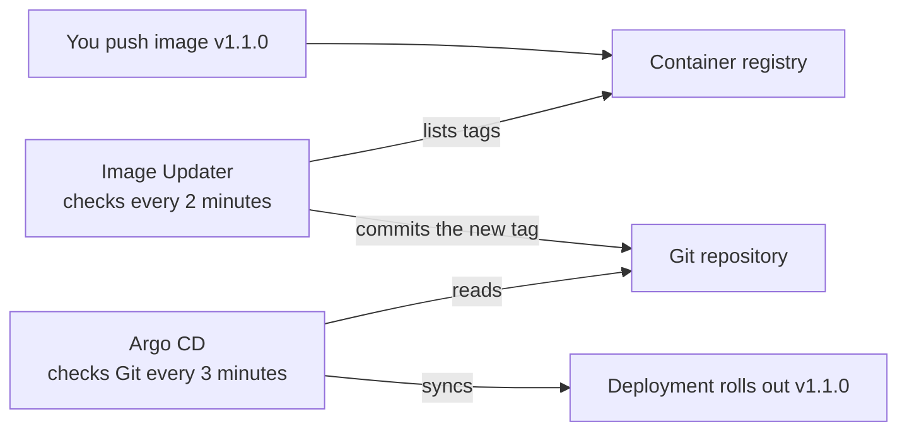
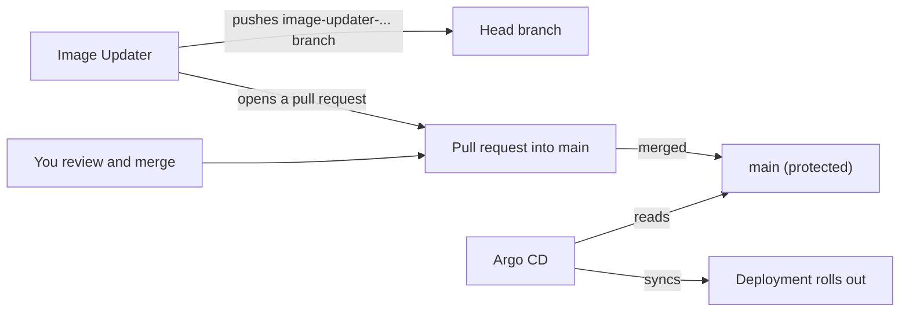

# Lab 03: Image Updater

**Goal:** publish a new image tag and watch it reach the cluster **with no human step**: Argo CD Image Updater finds
the tag, commits the decision to Git, and Argo CD rolls it out. Once for a Helm app and once for a Kustomize app, using
the **default write-back method**, which leaves your chart and overlay files untouched.

Suggested time: 45 minutes to read, 1 hour to repeat. Needs the cluster from
[Lab 01](../01-bootstrap-multi-tenancy/README.md).

> [!NOTE]
>
> **This lab is a captured run.** Image Updater commits to Git, so repeating it needs a Git repository you can push to,
> a token and an image you can push (see [Try it yourself](#try-it-yourself)). The outputs below come from a real run on
> the lab cluster, with a local registry (`lab-registry:5000`) and a throwaway local Git server in place of Docker Hub
> and GitHub, so the image names in the logs have that prefix. Everything else is unchanged.

> [!WARNING]
>
> **Never practise on a real project or with real credentials.** The updater pushes commits with whatever token you give
> it. Use a throwaway fork, a token that can write to **only that fork** and expires soon, and delete both when you are
> done.

> [!NOTE]
>
> **Versions.** Everything on this page was run on **Image Updater v1.5.0** (Helm chart `argocd-image-updater` 1.5.0) with
> Argo CD v3.6.1 (chart `argo-cd` 10.16.0). The first version of this lab used 1.0.1, and 1.5.0 changed the `ImageUpdater`
> API in ways that **make old manifests invalid**: read the next two sections before you apply anything.

## Read this first: `spec.namespace` was removed

The `spec.namespace` field no longer exists in the `ImageUpdater` API
([upgrade note](https://argocd-image-updater.readthedocs.io/en/stable/#namespace-field-removal)). The controller now looks
for Argo CD Applications **only in the namespace of the `ImageUpdater` resource itself**, so the resource must live in
the same namespace as the Applications it manages. A resource that still sets `spec.namespace` is **rejected**.

```diff
 apiVersion: argocd-image-updater.argoproj.io/v1alpha1
 kind: ImageUpdater
 metadata:
   name: hello
-  namespace: argocd
+  namespace: argocd        # the namespace of the Applications: this is now the only place that says it
 spec:
-  namespace: argocd        # REMOVED: the API server refuses this field
   writeBackConfig:
```

What the API server says depends on how the resource is applied. These are the real messages from this lab's cluster for
the old form:

```text
$ kubectl apply -f imageupdater-gitea.yaml
Error from server (BadRequest): error when creating "imageupdater-gitea.yaml": ImageUpdater in version "v1alpha1" cannot be handled as a ImageUpdater: strict decoding error: unknown field "spec.namespace"

$ kubectl apply --server-side -f imageupdater-gitea.yaml
Error from server: failed to create typed patch object (argocd/hello; argocd-image-updater.argoproj.io/v1alpha1, Kind=ImageUpdater): .spec.namespace: field not declared in schema
```

The second form is what a GitOps tool uses, so a manifest that still has the field **fails to sync** instead of
applying. The dangerous case is a client that skips validation:

```text
$ kubectl apply --validate=false -f imageupdater-gitea.yaml
imageupdater.argocd-image-updater.argoproj.io/hello created
```

The resource is created and the server **silently drops the unknown field**. Nothing tells you that `spec.namespace` did
nothing, and if it pointed at a different namespace than the resource, the updater now looks somewhere else.

### The same strictness catches other mistakes

The schema is strict everywhere, not only for `namespace`. While testing this lab, an earlier version of the manifest had a
`pullRequest` block indented one level too shallow (under `writeBackConfig` instead of under `gitConfig`) for one of the
two applications. The whole resource was refused:

```text
unknown field "spec.applicationRefs[1].writeBackConfig.pullRequest"
```

Check every `ImageUpdater` manifest against the real schema **before** you commit it. A server-side dry run needs no changes
to the cluster:

```bash
kubectl apply --dry-run=server -f imageupdater-gitea.yaml
```

```text
imageupdater.argocd-image-updater.argoproj.io/hello created (server dry run)
```

## What changed since 1.0

From the CRD of the running controller (`kubectl explain imageupdater.spec --recursive`), compared with the 1.0.1 CRD
this lab used before:

| Area | 1.0.1 | 1.5.0 |
|------|-------|-------|
| Where Applications are found | `spec.namespace` | The resource's own `metadata.namespace`. `spec.namespace` is **rejected** |
| Update strategy names | `semver`, `latest`, `digest`, `name` | `semver`, `newest-build`, `alphabetical`, `digest`, `calver` |
| Pull requests | None | `gitConfig.pullRequest` with `github`, `gitea`, `gitlab`, `azuredevops` and `labels` (from v1.2.0) |
| Required fields | `images`, `method` and `helm.name`/`helm.tag` were required | Not required. `helm.name` and `helm.tag` default to `image.name` and `image.tag` |
| Annotations | Not supported by the CR | `useAnnotations: true` reads the old `argocd-image-updater.argoproj.io/*` annotations of the Application |
| Image signatures | None | `imagesVerification` (a cosign public key in a Secret) at `spec`, `applicationRefs[]` and `images[]` level |
| Config management plugins | None | `manifestTargets.plugin` |

The rest of the page says where a result differs from the 1.0.1 run.

## Concepts



- **Update strategy.** How Image Updater picks the "newest" tag. Here `semver`: the highest semantic version. The 1.5.0
  CRD lists `semver`, `newest-build`, `alphabetical`, `digest` and `calver` as examples (1.0.1 listed `latest` and `name`).
- **Write-back method.** Where the decision is stored. `argocd` (the default when `method` is not set) changes the
  Application in the cluster only, so Git no longer says what runs; this lab does not use it. `git` **commits to Git**,
  which keeps Git the source of truth. `git:secret:<namespace>/<name>` is `git` with credentials read from a Secret.
- **What a `git` write-back writes.** Two choices, compared [below](#two-ways-to-write-back):
  - **The default: an override file.** With no `writeBackTarget`, Image Updater writes a small file called
    `.argocd-source-<application name>.yaml` **next to the application's sources**. Argo CD reads it and applies it on top
    of your chart or overlay. Your own files are never edited. **This is what the lab uses.**
  - **Editing the manifest.** With `writeBackTarget: helmvalues:<file>` or `kustomization`, it changes your
    `values.yaml` or `kustomization.yaml` itself.
- **The `ImageUpdater` resource.** Image Updater 1.x is configured with a custom resource, not with annotations on the
  Applications. One resource names the Applications to watch, the images in them and how to write the change back.

## The resource

[`imageupdater-gitea.yaml`](imageupdater-gitea.yaml), trimmed:

```yaml
apiVersion: argocd-image-updater.argoproj.io/v1alpha1
kind: ImageUpdater
metadata:
  name: hello
  namespace: argocd                       # where the Argo CD Applications live (there is no spec.namespace)
spec:
  writeBackConfig:
    method: git:secret:argocd/git-creds   # commit to Git, credentials from this Secret
    gitConfig:
      branch: main
      repository: https://github.com/Xeus-Territory/kubewekend   # use YOUR throwaway fork
      # no writeBackTarget: the default override file is written
      # no pullRequest: commits go straight to the branch (see "Open a pull request" for the alternative)
  commonUpdateSettings:
    updateStrategy: semver
    ignoreTags: [latest]
  applicationRefs:
    - namePattern: hello-helm
      # (the file repeats the same writeBackConfig for each application)
      images:
        - alias: todo
          imageName: xeusnguyen/kubewekend-todo
          manifestTargets:
            helm:
              name: common.image.repository   # the Helm values that hold the image
              tag: common.image.tag
    - namePattern: hello-kustomize-dev
      images:
        - alias: todo
          imageName: xeusnguyen/kubewekend-todo
          manifestTargets:
            kustomize:
              name: xeusnguyen/kubewekend-todo   # the name exactly as written in `images:`
```

> [!NOTE]
>
> The CRD still describes `writeBackTarget` as "required if the write-back method is Git". As in 1.0.1, it is not:
> leaving it out is what selects the override-file behaviour, and both applications were updated on 1.5.0.

> [!NOTE]
>
> This file commits **directly** to the branch. If your branch is protected and requires pull requests, apply
> [`imageupdater-github.yaml`](imageupdater-github.yaml) instead: it is the same resource with a `pullRequest` block (see
> [Open a pull request](#open-a-pull-request-instead-of-committing)). Apply **one** of the two files, not both, because
> they manage the same Applications.

Only two of the three apps are listed. **`hello-kustomize-prod` is not tracked**, so it stays on its old tag: a simple
way to see the difference between an environment that follows automatically and one that waits for a reviewed commit.

## Before

Everything runs `v1.0.0` (the `version` field of each app's `/version`, read with the `hello` helper from lab 00):

```text
hello-helm.kubewekend.local    v1.0.0
hello-dev.kubewekend.local     v1.0.0
hello-prod.kubewekend.local    v1.0.0
```

With only `v1.0.0` in the registry, Image Updater has nothing to do:

```text
Processing results: applications=2 images_considered=2 images_skipped=0 images_updated=0 errors=0
```

## Publish v1.1.0

`v1.1.0` is the same app with a new version, built from [`app/`](https://github.com/Xeus-Territory/kubewekend/tree/main/examples/argocd-apps/app).
(Add `--build-arg APP_MESSAGE="..."` if you also want the banner text to change.)

```bash
docker build -t xeusnguyen/kubewekend-todo:v1.1.0 --build-arg APP_VERSION=v1.1.0 $REPO/examples/argocd-apps/app
docker push xeusnguyen/kubewekend-todo:v1.1.0
```

## What Image Updater did

Within its next cycle (every two minutes) it found the tag and wrote it back. The log, trimmed to the important parts:

```text
Setting new image to .../xeusnguyen/kubewekend-todo:v1.1.0                      application=argocd/hello-helm
Successfully updated image '...:v1.0.0' to '...:v1.1.0', but pending spec update  application=argocd/hello-helm
Committing 1 parameter update(s) for application hello-helm                     application=argocd/hello-helm
Setting new image to .../xeusnguyen/kubewekend-todo:v1.1.0                      application=argocd/hello-kustomize-dev
Committing 1 parameter update(s) for application hello-kustomize-dev            application=argocd/hello-kustomize-dev
Successfully updated the live application spec                                  application=argocd/hello-helm
Successfully updated the live application spec                                  application=argocd/hello-kustomize-dev
Processing results: applications=2 images_considered=2 images_skipped=0 images_updated=2 errors=0
```

Git has two new commits, authored by the updater:

```text
293d49d argocd-image-updater <noreply@argoproj.io>
    build: automatic update of hello-kustomize-dev
a916376 argocd-image-updater <noreply@argoproj.io>
    build: automatic update of hello-helm
```

The body of each commit says `updates image xeusnguyen/kubewekend-todo tag 'v1.0.0' to 'v1.1.0'`. Each commit **adds one
new file** and touches nothing else. Look in the two source folders (`ls -A` shows hidden files):

```text
hello-helm:
.argocd-source-hello-helm.yaml
Chart.lock
Chart.yaml
.helmignore
values.yaml

hello-kustomize/overlays/dev:
.argocd-source-hello-kustomize-dev.yaml
kustomization.yaml
```

### The Helm override file

`workloads/hello-helm/.argocd-source-hello-helm.yaml`, 8 lines. It sets the two chart values you named in
`manifestTargets.helm`, as Helm parameters:

```yaml
helm:
  parameters:
  - name: common.image.repository
    value: lab-registry:5000/xeusnguyen/kubewekend-todo
    forcestring: true
  - name: common.image.tag
    value: v1.1.0
    forcestring: true
```

### The Kustomize override file

`workloads/hello-kustomize/overlays/dev/.argocd-source-hello-kustomize-dev.yaml`, 3 lines. It is the same thing as
`kustomize edit set image`:

```yaml
kustomize:
  images:
  - lab-registry:5000/xeusnguyen/kubewekend-todo=lab-registry:5000/xeusnguyen/kubewekend-todo:v1.1.0
```

On Docker Hub the image is `xeusnguyen/kubewekend-todo` (no registry prefix).

### Your own files did not change

This is the point of the method. The base files still say the **old** tag, while the new one is live:

```text
hello-helm/values.yaml:                  tag: "v1.0.0"
overlays/dev/kustomization.yaml:         newTag: v1.0.0

live:  hello-helm ...:v1.1.0    hello-dev ...:v1.1.0    hello-prod ...:v1.0.0
```

Argo CD merged the override files on top when it rendered the manifests. The Application object itself did not change
(`spec.source.helm` still holds only `releaseName` and `valueFiles`), and Argo CD reports the running image in
`status.summary.images`.

```text
hello-helm.kubewekend.local    v1.1.0
hello-dev.kubewekend.local     v1.1.0
hello-prod.kubewekend.local    v1.0.0
```

The whole thing took about 5 minutes (320 seconds here; the 1.0.1 run took 256). Image Updater checks the registry every **2 minutes**, and Argo CD
checks Git every **3 minutes** by default. Both can be tightened (a registry webhook for Image Updater, a Git webhook for
Argo CD).

### Ask the resource what it did

The `ImageUpdater` resource keeps a `status`, so you do not have to read the controller log to know whether it worked.
Trimmed to the useful fields:

```bash
kubectl -n argocd get imageupdater hello -o jsonpath='{.status}'
```

```text
applicationsMatched: 2
imagesManaged:       2
lastCheckedAt:       2026-11-25T02:17:38Z
lastUpdatedAt:       2026-11-25T02:17:38Z
conditions:
  Ready        True    "Reconciled 2 applications, 1 images updated."
  Error        False   "No errors during last reconciliation."
  Reconciling  False   "Last check completed. Awaiting next cycle."
recentUpdates:
  - alias: todo   newVersion: v1.1.0   applicationsUpdated: 1
    message: "Updated from v1.0.0 to v1.1.0."
```

(The real output is JSON; this is the same content laid out for reading.) `applicationsMatched: 2` is a quick check that
`namePattern` found the Applications.

A resource in the wrong namespace does not show `0` matches: it is **ignored completely**. In this lab a copy placed in the
`default` namespace (the Applications are in `argocd`) never got a `status` at all, and the controller log said nothing
about it. If `kubectl get imageupdater <name> -o jsonpath='{.status}'` prints nothing, check the namespace first.

### The next update is one line

Publishing `v1.2.0` changed the override file and nothing else. Both apps were on `v1.2.0` about 70 seconds after the
push:

```diff
   - name: common.image.tag
-    value: v1.1.0
+    value: v1.2.0
     forcestring: true
```

One small commit per update, one line each: that is easy to review and easy to revert.

## Two ways to write back

| | **Override file** (default, no `writeBackTarget`) | **Edit the manifest** (`writeBackTarget`) |
|---|---|---|
| Setting | Leave `writeBackTarget` out | `helmvalues:<file>` or `kustomization` |
| What lands in Git | A hidden file next to the app: `.argocd-source-<app>.yaml` | A change inside your `values.yaml` or `kustomization.yaml` |
| First update | A new 8-line (Helm) or 3-line (Kustomize) file | A change in your file |
| Later updates | One line | One line. The first Helm write reformats the whole file once (see below) |
| Your chart and overlay files | **Never touched.** They keep the tag you wrote | Rewritten by the updater |
| Fits | Any chart or overlay, however large or generated: you only name the values | Charts and overlays where you want the tag visible in the file you read |
| Where the tag lives | Two places: your file (the baseline) and the override file (what runs, wins) | One place |
| Watch out | A reader of `values.yaml` sees an old tag | The first Helm write is a big reformat, and an old override file would still win (see below) |

**Why the override file suits custom charts.** The updater only needs two value names (`common.image.repository` and
`common.image.tag` here). It never parses or rewrites your chart, so a large `values.yaml` full of comments, anchors or
template-generated content is left exactly as you wrote it, and the commit stays tiny.

### The other method: editing the manifest

To use it, set `writeBackTarget: helmvalues:values.yaml` (Helm) and `writeBackTarget: kustomization` (Kustomize) under the
`gitConfig` of each application. The change then lands in your own files, and no new override files are written.

The **Kustomize** diff is small. It bumps `newTag`, and it also adds `newName`, because that is what `kustomize edit set
image` does:

```diff
   - name: lab-registry:5000/xeusnguyen/kubewekend-todo
-    newTag: v1.0.0
+    newTag: v1.3.0
+    newName: lab-registry:5000/xeusnguyen/kubewekend-todo
```

The **Helm** write is a big diff the **first time**. The updater re-serialises `values.yaml`: 12 insertions and 20 deletions
for a one-word change. It drops blank lines and re-indents lists, and it keeps your comments:

```diff
@@ -10,9 +9,7 @@ common:
     pullPolicy: IfNotPresent
-    tag: "v1.0.0"
-
+    tag: "v1.2.0"
   containerPorts:
-    - name: http
-      containerPort: 3000
-      protocol: TCP
-
+  - name: http
+    containerPort: 3000
+    protocol: TCP
   service:
```

After that the file is in the updater's own format, so the **next** update is one line (1 insertion, 1 deletion):

```diff
-    tag: "v1.2.0"
+    tag: "v1.3.0"
```

This is the same on 1.0.1 and 1.5.0. The reformat is a one-time cost, but it will show up in the first review.

### Switching methods: delete the old override files

If you move an application from the override file to `writeBackTarget`, the old `.argocd-source-<app>.yaml` is still in
Git, and **it still wins**. In the test the updater edited `values.yaml` and `kustomization.yaml` to `v1.3.0`, but the
apps stayed on `v1.2.0` until the two override files were deleted:

```text
manifests say v1.3.0, override files still in Git:  hello-helm=v1.2.0  hello-dev=v1.2.0  hello-prod=v1.0.0
after deleting the two override files:               hello-helm=v1.3.0  hello-dev=v1.3.0  hello-prod=v1.0.0
```

The manifests were updated about 130 seconds after the push, so a pipeline that only checks Git would have looked healthy
while the cluster ran the old image. Always check what is **live** (`status.summary.images` of the Application, or the
image of the Deployment), not only what is in Git.

## Undo and pin

The override file is an ordinary file, so you can see what happens when you remove it. With the updater paused (its
controller scaled to zero), deleting the two files in Git and refreshing the applications put both apps back on the tag
in your own files within about five seconds:

```text
now (updater running):                  hello-helm=v1.2.0  hello-dev=v1.2.0  hello-prod=v1.0.0
override files deleted, updater paused: hello-helm=v1.0.0  hello-dev=v1.0.0  hello-prod=v1.0.0
```

Then the updater was resumed, and it wrote both files again within 20 seconds, back to the newest tag:

```text
override files written again after +20s: 00a6f61 argocd-image-updater: build: automatic update of hello-helm
                                         5f8d9a5 argocd-image-updater: build: automatic update of hello-kustomize-dev
live again:                             hello-helm=v1.2.0  hello-dev=v1.2.0  hello-prod=v1.0.0
```

So **deleting the file does not pin a version**: while an application is listed in the `ImageUpdater` resource, the
updater keeps writing it. To hold an environment on a tag, stop the updater for that application (remove it from
`applicationRefs`, or delete the resource), or narrow which tags are eligible (see `allowTags` and `ignoreTags` in the
[reference](#configuration-reference)). To **promote** a tag to an environment that is not tracked, such as
`hello-kustomize-prod`, change its own `kustomization.yaml` in a normal reviewed commit.

## Open a pull request instead of committing

> [!NOTE]
>
> **Run on Image Updater 1.5.0 against the local Gitea** (`pullRequest.gitea`) with a protected `main`: the captured
> output below is from that run. The GitHub examples differ only in the provider key (`github: {}`) and the credentials.
> They come from the official documentation and were **not** run against GitHub. Pull request support starts in Image
> Updater **v1.2.0**; 1.0.1 has no `pullRequest` field.

Everything above pushes straight to the branch Argo CD tracks. That fails when the branch is **protected**. **Pull request
mode** keeps the same `git` write-back but changes the last step: instead of pushing to `main`, the updater

1. pushes the update commit to a **new head branch** it names itself, `image-updater-<targetKey>-<sha256>`, where
   `<targetKey>` is a short hash of the write-back target (repository, branch and target path), and
2. **opens a pull request** from that branch into the base branch you configured.

Nothing changes in the cluster until a person reviews and merges the pull request, and Argo CD then syncs the merged
commit as usual.



### First, see the problem: a protected branch rejects direct commits

With `main` protected (no direct pushes, not even for the repository owner) and the resource still committing directly, the
tag `v2.0.0` was found and the push was refused. This is the log, trimmed, once per application and every cycle:

```text
Could not update application spec: could not push main to origin: `git push origin main` failed exit status 1:
remote: error: Not allowed to push to protected branch main
 ! [remote rejected] main -> main (pre-receive hook declined)
```

The update is lost: the applications stay on the old tag until someone fixes the write-back. A branch that requires pull
requests on another provider, such as GitHub, refuses a direct push in the same spirit, but the wording of the error
differs: this was only run on Gitea.

### Then switch to pull requests

The only change to the resource is a `pullRequest` block under `gitConfig` (provider `gitea` here, `github` on GitHub):

```yaml
    gitConfig:
      repository: https://lab-gitea:3000/lab/kubewekend
      branch: main              # the BASE branch only
      pullRequest:
        gitea: {}
```

**Use `gitea` for Gitea and for Forgejo, and `github` for GitHub.** The provider key chooses which API the updater
calls, so it has to match your Git server. [`imageupdater-github.yaml`](imageupdater-github.yaml) uses `github`: change
it to `gitea` if you use that file against a Gitea server. See the
[Gitea section](https://argocd-image-updater.readthedocs.io/en/stable/basics/update-methods/#gitea) of the update methods page.

About 10 seconds after applying it, **two pull requests** were open, one per application:

```text
#2  build: automatic update of hello-kustomize-dev
    head: image-updater-97484f75-7dc8aa2d8390...  ->  base: main    state: open
    body: updates image xeusnguyen/kubewekend-todo tag 'v1.4.0' to 'v2.0.0'
#1  build: automatic update of hello-helm
    head: image-updater-56863fc9-7dc8aa2d8390...  ->  base: main    state: open
    body: updates image xeusnguyen/kubewekend-todo tag 'v1.4.0' to 'v2.0.0'
```

Each pull request changes the override file of its own application, one line:

```text
examples/argocd-apps/workloads/hello-kustomize/overlays/dev/.argocd-source-hello-kustomize-dev.yaml  +1 -1
```

While the pull requests were open nothing changed in the cluster:

```text
hello-helm=v1.4.0  hello-dev=v1.4.0  hello-prod=v1.0.0
```

Merging both (here through the Gitea API, as a reviewer would in the web page) and refreshing the applications moved them
to `v2.0.0` within about five seconds:

```text
28203e4 lab: Merge pull request 'build: automatic update of hello-helm' (#1) from image-updater-56863fc9-... into main
52aab82 lab: Merge pull request 'build: automatic update of hello-kustomize-dev' (#2) from image-updater-97484f75-... into main

hello-helm=v2.0.0  hello-dev=v2.0.0  hello-prod=v1.0.0
```

What this run showed:

- **The default override file works in pull request mode.** No `writeBackTarget` was set, and each pull request carried the
  one-line `.argocd-source-<app>.yaml` change.
- **One pull request per application**, because each application has its own override file and therefore its own write-back
  target and its own head branch. The docs say applications that share a write-back target reuse one head branch.
- **Expect one fetch error per application the first time.** The updater first tries to fetch its head branch, which does not
  exist yet, so the log has ``git fetch origin image-updater-...` failed ... couldn't find remote ref`` once, and the branch
  is created right after.
- **The labels were not attached.** The resource asked for `image-update` and `automated`, and the pull requests had none:
  on Gitea only labels that **already exist** in the repository are attached, and a labelling failure does not fail the
  update. Create the labels first.

### Examples

The repository ships one ready-made file, [`imageupdater-github.yaml`](imageupdater-github.yaml): GitHub, with `pullRequest`
set **once**, inside the global `gitConfig`, while each application repeats its own `writeBackConfig` without it. That is the
shape of the official example. It was checked against the 1.5.0 schema but **not run** against GitHub. Example 2 is its
smallest form.

**Example 1: Gitea or Forgejo (the one tested here).** Same shape, with the `gitea` provider (not `github`) and a token.
The [Gitea section](https://argocd-image-updater.readthedocs.io/en/stable/basics/update-methods/#gitea) of the docs covers it:

```yaml
spec:
  writeBackConfig:
    method: git:secret:argocd/git-creds    # username + a Gitea access token as the password
    gitConfig:
      repository: https://lab-gitea:3000/lab/kubewekend
      branch: main
      pullRequest:
        gitea: {}
        labels:
          - image-update                    # must already exist in the repository
          - automated
```

**Example 2: GitHub, with the default override file.** The smallest change from `imageupdater-gitea.yaml`. Keep `branch`
as the base branch only:

```yaml
spec:
  writeBackConfig:
    method: git:secret:argocd/git-creds    # a token (PAT or GitHub App), not an SSH key
    gitConfig:
      repository: https://github.com/<you>/<throwaway-fork>.git
      branch: main                         # the BASE branch; no "base:target" form in PR mode
      pullRequest:
        github: {}
```

**Example 3: GitHub, editing the manifest (per-application target).** This is the shape of the official example. The pull
request changes your own `values.yaml` or `kustomization.yaml`. A path that starts with `/` is relative to the repository
root. `helmvalues:` takes a values **file**, `kustomization:` takes a **directory**:

```yaml
spec:
  writeBackConfig:
    method: git:secret:argocd/git-creds
    gitConfig:
      repository: https://github.com/<you>/<throwaway-fork>.git
      branch: main
      pullRequest:
        github: {}
  applicationRefs:
    - namePattern: hello-helm
      writeBackConfig:
        method: git:secret:argocd/git-creds
        gitConfig:
          branch: main
          writeBackTarget: helmvalues:/examples/argocd-apps/workloads/hello-helm/values.yaml
      images:
        - alias: todo
          imageName: xeusnguyen/kubewekend-todo
          manifestTargets:
            helm:
              name: common.image.repository
              tag: common.image.tag
    - namePattern: hello-kustomize-dev
      writeBackConfig:
        method: git:secret:argocd/git-creds
        gitConfig:
          branch: main
          writeBackTarget: kustomization:/examples/argocd-apps/workloads/hello-kustomize/overlays/dev
      images:
        - alias: todo
          imageName: xeusnguyen/kubewekend-todo
          manifestTargets:
            kustomize:
              name: xeusnguyen/kubewekend-todo
```

**Example 4: GitHub, with labels.** On GitHub the labels are applied in a follow-up call after the pull request exists. If
that call fails, for example because the token cannot write issues, the updater logs a warning and the pull request is
**still created**:

```yaml
      pullRequest:
        github: {}
        labels:
          - image-update
          - automated
```

### Run it yourself on the local Gitea

This is what the captured run did, on the setup from [lab 00](../00-platform/README.md#practise-locally-with-gitea-and-a-registry-no-github)
(`$LAB_DIR` and `$LAB_TLS` are its variables). The pull request API **always verifies TLS**, so the self-signed Gitea needs
two extra steps that the plain Git operations did not.

**1. Let the controller trust Gitea's certificate.** The controller reads trusted certificates from the directory in
`ARGOCD_TLS_DATA_PATH`, one file per host name. Put the certificate in a ConfigMap, then mount it through the Argo CD
values of the scratch copy (`image-updater:` is the sub-chart key):

```bash
kubectl -n argocd create configmap lab-gitea-tls --from-file=lab-gitea=$LAB_TLS/cert.pem
cat >> $LAB_DIR/examples/argocd-apps/manifests/infrastructure/argocd/values.yaml <<'EOF'
  extraEnv:
    - name: ARGOCD_TLS_DATA_PATH
      value: /app/config/scm-tls
  volumes:
    - name: scm-tls
      configMap:
        name: lab-gitea-tls
  volumeMounts:
    - name: scm-tls
      mountPath: /app/config/scm-tls
EOF
cd $LAB_DIR && git add -A && git commit -q -m "trust the local Gitea certificate" && git push -q origin main
```

Argo CD applies the change to the Image Updater controller. Wait for its rollout:

```bash
kubectl -n argocd rollout status deploy/argocd-image-updater-controller
```

**2. Use an access token, not the password.** Pull request mode needs a bearer token. Create one in Gitea and put it in the
`git-creds` Secret:

```bash
TOKEN=$(curl -sk -u lab:lab-password-1 -H 'Content-Type: application/json' \
  -d '{"name":"image-updater","scopes":["write:repository","write:issue"]}' \
  https://127.0.0.1:3001/api/v1/users/lab/tokens | python3 -c 'import json,sys; print(json.load(sys.stdin)["sha1"])')
kubectl -n argocd create secret generic git-creds --from-literal=username=lab --from-literal=password=$TOKEN \
  --dry-run=client -o yaml | kubectl apply -f -
```

**3. Protect `main`, so direct commits fail.**

```bash
curl -sk -u lab:lab-password-1 -H 'Content-Type: application/json' \
  -d '{"branch_name":"main","rule_name":"main","enable_push":false,"required_approvals":0,"apply_to_admins":true}' \
  https://127.0.0.1:3001/api/v1/repos/lab/kubewekend/branch_protections
```

**4. Use the `gitea` provider.** Start from `imageupdater-gitea.yaml` in your scratch copy
(`$LAB_DIR/examples/argocd-apps/labs/03-image-updater/imageupdater-gitea.yaml`) and add `pullRequest: gitea: {}` under the
`gitConfig` of each application, as in the test run. (`imageupdater-github.yaml` sets it once, globally; that shape was not
run here, and if you start from it you must change `github` to `gitea`.) Check it, apply it, and publish a new tag:

```bash
kubectl apply --dry-run=server -f $LAB_DIR/examples/argocd-apps/labs/03-image-updater/imageupdater-gitea.yaml
kubectl apply -f $LAB_DIR/examples/argocd-apps/labs/03-image-updater/imageupdater-gitea.yaml
docker tag localhost:5001/xeusnguyen/kubewekend-todo:v1.1.0 localhost:5001/xeusnguyen/kubewekend-todo:v2.0.0
docker push localhost:5001/xeusnguyen/kubewekend-todo:v2.0.0
```

**5. Review and merge.** Open `https://localhost:3001` (user `lab`, password `lab-password-1`), look at the two pull requests and
merge them, or list and merge them through the API. Then refresh the applications (`argocd.argoproj.io/refresh=hard`
annotation, or wait up to three minutes) and watch `hello hello-dev` change.

### What to know before you use it

| Topic | Note |
|-------|------|
| Credentials | A bearer token is required (a personal access token or a GitHub App), given through `method: git:secret:<ns>/<name>`. In the test, a Gitea access token with `write:repository` and `write:issue` was the Secret's password. **SSH keys do not work**, because the updater must call the provider's API. The commits and the pull request are authored as that token's identity |
| Token permissions | Enough to push a branch and open a pull request on that repository. Labels also need permission to write issues. Use a token limited to one throwaway repository, with a short expiry, and check your provider's current permission names |
| Branch setting | Only the base branch, for example `main`. A value with a colon (`base:target`) together with `pullRequest` is a **validation error** and the resource is not reconciled |
| Head branch | `image-updater-<targetKey>-<sha256>`, for example `image-updater-56863fc9-7dc8aa2d8390...`. If a pull request for the same head and base is already open, the updater leaves it alone instead of opening a duplicate |
| One per application | Applications with different write-back targets get different head branches and **separate pull requests** (two in the test). Applications that share a target share one |
| Title and body | In the test, the title was the first line of the commit message (`build: automatic update of <app>`) and the body was `updates image <image> tag '<old>' to '<new>'`. Both come from the commit message template, so you can change them there. The docs list a different default title, so check what your version produces |
| Labels | `pullRequest.labels` applies labels to every pull or merge request. On Gitea only labels that already exist in the repository are attached, and a labelling failure does not fail the update |
| Other providers | `github`, `gitea` (also Forgejo; see the [Gitea section](https://argocd-image-updater.readthedocs.io/en/stable/basics/update-methods/#gitea)), `gitlab` (opens a merge request) and `azuredevops`, each an empty object under `pullRequest`. Pick the one that matches your server |
| TLS | Calls to the provider's API **always** verify TLS, even if the repository is registered as `insecure` in Argo CD, because they carry the token. A self-signed server must be trusted through `ARGOCD_TLS_DATA_PATH`, as in the steps above. A public GitHub needs nothing |
| After an upgrade | The head branch used to be named from the application (`image-updater-<namespace>-<appName>-<sha256>`). Newer releases name it from the write-back target. After upgrading, the first run creates a branch with the new name, and **old pull requests are not closed for you**: close them and delete their branches by hand |
| Latency | The application stays on the old tag until the pull request is merged and Argo CD has synced. After the merge it took about five seconds here once the applications were refreshed; otherwise Argo CD checks Git every three minutes |

> [!TIP]
>
> Use pull request mode for environments that are protected, such as production overlays, and direct commits for
> environments you want to follow automatically, such as `dev`. The repository keeps the two modes in **two files** so each
> one stays simple. To run both at once, split the applications between **two `ImageUpdater` resources** with different
> names and different `namePattern`s, so they never manage the same Application. The docs show a global `pullRequest` with
> per-application overrides (the shape of `imageupdater-github.yaml`) but do not describe mixing modes inside one resource.

## Break it: an `http://` repository

Image Updater builds Git credentials from a Secret only for `https://` and `ssh` URLs. This is the same on 1.0.1 and 1.5.0.
With a plain `http://` repository it finds the new tag and then fails at the last step:

```text
Could not update application spec: could not get creds for repo 'http://lab-gitea:3000/lab/kubewekend': unknown repository type
Processing results: applications=2 images_considered=2 images_skipped=0 images_updated=0 errors=2
```

The error does not say "use https", so remember it: `unknown repository type` means the `repository` URL is not
`https://` or `ssh`. GitHub, GitLab and most Git servers are fine.

## Configuration reference

Every field of the `ImageUpdater` resource in version **1.5.0**, with the meaning taken from the CRD of the running
controller (`kubectl explain imageupdater.spec --recursive`). **Used here** says whether this lab sets the field.
**New** marks fields that did not exist in 1.0.1.

> [!WARNING]
>
> `spec.namespace` is **not** in this list: it was removed in 1.5.0 and a resource that sets it is rejected (see
> [the top of this page](#read-this-first-specnamespace-was-removed)).

### Where settings can be given

`commonUpdateSettings`, `writeBackConfig` and `imagesVerification` can be set at several levels, and the **more specific
level wins**:

1. `spec`: the default for everything in the resource
2. `spec.applicationRefs[]`: for the applications that entry selects
3. `spec.applicationRefs[].images[]`: for one image (`commonUpdateSettings` and `imagesVerification` only)

### `metadata` and `spec`

| Field | Meaning | Used here |
|-------|---------|-----------|
| `metadata.namespace` | The namespace the controller searches for Argo CD Applications. It must be the namespace of the Applications. A resource in a namespace the controller does not watch is ignored | Yes (`argocd`) |
| `spec.applicationRefs[]` (required) | Rules that select Applications **in the resource's namespace** and say how to update their images | Yes |
| `spec.commonUpdateSettings` | Defaults for update strategy, tag filtering and pull secrets | Yes |
| `spec.writeBackConfig` | Defaults for how and where to write back the change | Yes |
| `spec.imagesVerification` (**new**) | Default image-signature policy. When set, every update is verified before it is committed to Git or applied | No |

### `writeBackConfig`

| Field | Meaning | Used here |
|-------|---------|-----------|
| `method` | How to write back. Defaults to `argocd` when not set. `git` commits to Git; `git:secret:<ns>/<name>` is `git` with credentials from a Secret. (Not required in 1.5.0; it was in 1.0.1) | `git:secret:argocd/git-creds` |
| `gitConfig.branch` | Branch to commit to, or the **base** branch in pull request mode. Required for `git` unless set at the `spec` level | `main` |
| `gitConfig.repository` | Repository URL. If left out, it is taken from the Application's `spec.source.repoURL` | Yes |
| `gitConfig.writeBackTarget` | The file to change, such as `helmvalues:./helm/values.yaml` or `kustomization:./kustomize/overlays/production`. **Leave it out for the override file** | Omitted (the manifest-editing variant sets it) |
| `gitConfig.pullRequest` (**new**) | Open a pull request instead of pushing to the branch. Pick the provider inside it. See [Open a pull request](#open-a-pull-request-instead-of-committing) | Only in `imageupdater-github.yaml` |
| `gitConfig.pullRequest.github`, `.gitea`, `.gitlab`, `.azuredevops` (**new**) | Choose the provider. Each is an empty object (`github: {}`). `gitea` is also used for Forgejo; GitLab opens a merge request | `github: {}` in `imageupdater-github.yaml` |
| `gitConfig.pullRequest.labels` (**new**) | Labels for every pull or merge request. GitLab sets them on creation; the others apply them in a follow-up call, so a labelling failure does not fail the update | In `imageupdater-github.yaml` |

`gitConfig` is only valid when `method` is `git` or starts with `git:`. The CRD text still says `writeBackTarget` is "required"
for `git`; it is not (see [The resource](#the-resource)).

### `commonUpdateSettings`

| Field | Meaning | Used here |
|-------|---------|-----------|
| `updateStrategy` | How the newest tag is chosen: `semver`, `newest-build`, `alphabetical`, `digest`, `calver` (1.0.1 had `latest` and `name`) | `semver` |
| `allowTags` | A regular expression; only matching tags are eligible | No |
| `ignoreTags` | A list of glob-like patterns of tags to ignore | `latest` |
| `forceUpdate` | Whether updates should be forced | No |
| `platforms` | Target platforms to consider, such as `linux/amd64` and `linux/arm64`, when checking for new versions or digests | No |
| `pullSecret` | The pull secret to use for the images, for example `pullsecret:argocd/regcred` | No |

### `applicationRefs[]`: which applications

| Field | Meaning | Used here |
|-------|---------|-----------|
| `namePattern` (required) | A glob pattern for the Application name | Exact names |
| `labelSelectors.matchLabels` | Select Applications by label (`key: value`) | No |
| `labelSelectors.matchExpressions` | Select Applications by label expressions (`In`, `NotIn`, `Exists`, `DoesNotExist`). All requirements are ANDed | No |
| `images[]` | The images to update in the selected Applications. Not required in 1.5.0 (it was in 1.0.1) | Yes |
| `useAnnotations` (**new**) | When `true`, read the image configuration from the Application's `argocd-image-updater.argoproj.io/*` annotations instead of `images[]`. Only `namePattern` and `labelSelectors` are used then; every other field is ignored | No |
| `commonUpdateSettings`, `writeBackConfig`, `imagesVerification` | Override the `spec`-level settings for these Applications (ignored when `useAnnotations` is `true`) | `writeBackConfig` repeated |

> [!TIP]
>
> The CRD says `namePattern` is a glob, so an entry such as `hello-kustomize-*` should cover every Application the
> ApplicationSet generates, and with the override file you do not need a per-application path in `writeBackTarget`. This
> lab only used exact names, so test the glob before relying on it. Label selectors work the same way if the ApplicationSet
> template adds a label.

### `images[]`: which images and where they live

| Field | Meaning | Used here |
|-------|---------|-----------|
| `alias` (required) | A short name for this image. Must be unique within one `applicationRefs` entry | `todo` |
| `imageName` (required) | The image to track: the registry (if not Docker Hub), the name and the initial or current tag. It is what is used to query the registry | Yes |
| `commonUpdateSettings` | Overrides the settings for this one image | No |
| `imagesVerification` (**new**) | Signature policy for this one image; beats the `spec` and `applicationRefs[]` levels | No |
| `manifestTargets` | Where the image appears in the manifests. Optional, and **exactly one** of `helm`, `kustomize` or `plugin` | Yes |

### `manifestTargets`

| Field | Meaning | Used here |
|-------|---------|-----------|
| `helm.name` | Dot-separated path to the chart value for the image repository, such as `image.repository` or `frontend.deployment.image.name`. Defaults to `image.name` when neither `spec` nor `name`/`tag` is set | `common.image.repository` |
| `helm.tag` | Dot-separated path to the chart value for the tag, such as `image.tag`. Defaults to `image.tag` when neither `spec` nor `name`/`tag` is set | `common.image.tag` |
| `helm.spec` | Dot-separated path to **one** value that holds the whole image string (`image/name:1.0`). For charts that take a single `image:` field. When set, `name` and `tag` are ignored | No |
| `kustomize.name` (required with `kustomize`) | The image name as it appears in the `images:` list of the `kustomization.yaml` | `xeusnguyen/kubewekend-todo` |
| `plugin.name`, `plugin.tag`, `plugin.spec` (**new**) | For Config Management Plugin apps: the **environment variable** names that carry the image repository, the tag, or the whole string. With `argocd` write-back they go into `spec.source.plugin.env`; with `git` write-back they go into `.argocd-source-<appName>.yaml` | No |

For a chart that does not follow the `image.repository` and `image.tag` convention, only the names in
`manifestTargets.helm` change. With the default method nothing in the chart has to change.

### `imagesVerification` (new)

Signature verification before an update is accepted. Not used in this lab.

| Field | Meaning |
|-------|---------|
| `enabled` | Turns verification on or off at this level. Defaults to `true` when the block is present; set `false` to opt one image or group out |
| `cosignKey.secretName`, `cosignKey.key` | A Secret **in the resource's namespace** that holds a PEM-encoded ECDSA public key (for example the key `cosign.pub`), which selects cosign key-based verification |

### The `status`

| Field | Meaning |
|-------|---------|
| `applicationsMatched`, `imagesManaged` | How many Applications `namePattern` and `labelSelectors` found, and how many images the resource manages |
| `lastCheckedAt`, `lastUpdatedAt` | When the last check ran and when an image was last updated |
| `conditions` | `Ready`, `Reconciling` and `Error`, each with a reason and a message |
| `recentUpdates[]` | The latest updates: alias, image, `newVersion`, how many applications were updated and a message |

## Try it yourself

**No GitHub account, or want zero risk?** Use the local Gitea and registry from
[lab 00](../00-platform/README.md#practise-locally-with-gitea-and-a-registry-no-github): it sets everything up and ends
with exactly this lab, run against containers on your own machine.

Otherwise you need a **throwaway fork** (see [lab 00](../00-platform/README.md#using-your-own-fork-needed-for-one-step-in-lab-2)),
an image repository you can push to, and a Git token that can write to **only that fork**. Do not use your real project.

**Is the branch protected?** Apply `imageupdater-github.yaml` instead of `imageupdater-gitea.yaml` below. It opens a pull
request, and the token must be allowed to push a branch and open pull requests on the fork.

1. Change `xeusnguyen/kubewekend-todo` to your image everywhere it appears (`workloads/` and `imageupdater-gitea.yaml`) and
   push, or keep the public image and only change `repository` in the resource to your fork.
2. Create the credentials. Never commit the token, and give it a short expiry:

   ```bash
   kubectl -n argocd create secret generic git-creds \
     --from-literal=username=<your-github-user> \
     --from-literal=password=<token-limited-to-the-fork>
   ```

3. Check the resource against the real schema, then apply it and follow the log. The dry run catches a removed field such
   as `spec.namespace`, or a block at the wrong indentation, before anything changes:

   ```bash
   kubectl apply --dry-run=server -f $REPO/examples/argocd-apps/labs/03-image-updater/imageupdater-gitea.yaml
   kubectl apply -f $REPO/examples/argocd-apps/labs/03-image-updater/imageupdater-gitea.yaml
   kubectl -n argocd logs deploy/argocd-image-updater-controller -f | grep -E 'new image|Committing|images_updated|error'
   ```

4. Build and push `v1.1.0` as shown above, then watch the log, `git pull` in your fork to see the two new
   `.argocd-source-*.yaml` files, and run `hello hello-dev` (the helper from lab 00).

For a private registry add `pullSecret: pullsecret:argocd/regcred` under `commonUpdateSettings`. A self-hosted registry
(like the local one used for the capture, which is plain HTTP) needs an entry under `config.registries` in the Image
Updater values.

## Self-check

- Why does the `git` write-back method keep Git the source of truth, and what would `argocd` do instead?
- After the update, `values.yaml` says `v1.0.0` but `v1.1.0` is running. Where does the running tag come from, and which
  one wins?
- `hello-kustomize-prod` has the same image as `dev`. Why did it not change, and how would you promote the tag to it?
- You delete `.argocd-source-hello-helm.yaml` and the updater is still running. What happens, and how do you really hold
  the app on a tag?
- When would you choose `writeBackTarget` over the override file, and what do you give up?
- You upgrade to Image Updater 1.5 with a manifest that still has `spec.namespace`. What happens with `kubectl apply`, with
  server-side apply and with `--validate=false`, and which of the three is the dangerous one?
- You switch an application from the override file to `writeBackTarget`, and Git shows the new tag but the cluster does
  not change. What did you forget to delete?
- `kubectl get imageupdater hello -o jsonpath='{.status}'` prints nothing. What is the first thing you check?
- Your `main` branch requires pull requests and forbids direct pushes. What does the updater do with the settings in this
  lab, and which single setting changes that?
- In pull request mode, why must `branch` be only the base branch, and what name does the updater give to the branch it
  creates?
- You publish release-candidate tags such as `v1.2.0-rc1` and do not want production-like environments to follow them.
  Which settings in `commonUpdateSettings` would you use to control which tags are eligible?

## Cleanup

```bash
kubectl -n argocd delete imageupdater hello
kubectl -n argocd delete secret git-creds
```

In your fork, remove the files the updater created (`git rm` the two `.argocd-source-*.yaml` files), then delete the token
you made for this lab.

Next: [Lab 04: argocd-agent](../04-argocd-agent/README.md).
