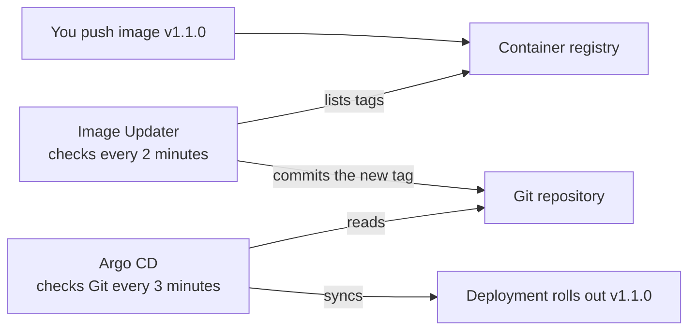

# Lab 03: Image Updater

**Goal:** publish a new image tag and watch it reach the cluster **with no human step**: Argo CD Image Updater finds
the tag, commits it to Git, and Argo CD rolls it out. Once for a Helm app and once for a Kustomize app.

Suggested time: 30 minutes to read, 1 hour to repeat. Needs the cluster from
[Lab 01](../01-bootstrap-multi-tenancy/README.md).

> [!NOTE]
>
> **This lab is a captured run.** Image Updater commits to Git, so repeating it needs your own fork, a Git token and an
> image you can push (see [Try it yourself](#try-it-yourself)). The outputs below come from a real run on the lab
> cluster, with a local registry (`argolab-registry:5000`) and a local Git server in place of Docker Hub and GitHub, so
> the image names in the logs have that prefix. Everything else is unchanged.

## Concepts



- **Update strategy.** How Image Updater picks the "newest" tag. Here `semver`: the highest semantic version. Others
  include `newest-build` (the most recent build date) and `digest` (follow one mutable tag).
- **Write-back method.** Where the decision is stored. `argocd` changes the Application in the cluster only, so Git
  no longer says what runs. `git` **commits the new tag to Git**, which keeps Git the source of truth. This lab uses `git`.
- **The `ImageUpdater` resource.** Image Updater 1.x is configured with a custom resource, not with annotations on the
  Applications. One resource names the Applications to watch, the images in them and how to write the change back.

## The resource

[`imageupdater.yaml`](imageupdater.yaml), trimmed:

```yaml
apiVersion: argocd-image-updater.argoproj.io/v1alpha1
kind: ImageUpdater
metadata:
  name: hello
  namespace: argocd
spec:
  namespace: argocd                       # where the Argo CD Applications live
  writeBackConfig:
    method: git:secret:argocd/git-creds   # commit to Git, credentials from this Secret
    gitConfig:
      branch: main
      repository: https://github.com/Xeus-Territory/kubewekend   # use YOUR fork
  commonUpdateSettings:
    updateStrategy: semver
    ignoreTags: [latest]
  applicationRefs:
    - namePattern: hello-helm
      writeBackConfig:                    # (method and gitConfig repeated per application)
        gitConfig:
          writeBackTarget: helmvalues:values.yaml
      images:
        - alias: todo
          imageName: xeusnguyen/kubewekend-todo
          manifestTargets:
            helm:
              name: common.image.repository   # value paths in values.yaml
              tag: common.image.tag
    - namePattern: hello-kustomize-dev
      writeBackConfig:
        gitConfig:
          writeBackTarget: kustomization
      images:
        - alias: todo
          imageName: xeusnguyen/kubewekend-todo
          manifestTargets:
            kustomize:
              name: xeusnguyen/kubewekend-todo   # the name exactly as written in `images:`
```

| Field | Meaning |
|-------|---------|
| `namePattern` | Which Argo CD Applications to look at (exact name or a pattern) |
| `images[].imageName` | The image to track |
| `manifestTargets.helm` | Which values in `values.yaml` hold the repository and the tag |
| `manifestTargets.kustomize` | Which entry of `images:` in `kustomization.yaml` to edit |
| `writeBackTarget` | The file to change: `helmvalues:<file>` or `kustomization` |

Only two of the three apps are listed. **`hello-kustomize-prod` is not tracked**, so it stays on its old tag: a simple
way to see the difference between an environment that follows automatically and one that waits for a reviewed commit.

## Before

Everything runs `v1.0.0`:

```text
hello-helm.kubewekend.local    v1.0.0 | Hello from Kubewekend
hello-dev.kubewekend.local     v1.0.0 | Hello from Kubewekend
hello-prod.kubewekend.local    v1.0.0 | Hello from Kubewekend
```

With only `v1.0.0` in the registry, Image Updater has nothing to do:

```text
Processing results: applications=2 images_considered=2 images_skipped=0 images_updated=0 errors=0
```

## Publish v1.1.0

`v1.1.0` is the same app with a different banner message, built from [`app/`](https://github.com/Xeus-Territory/kubewekend/tree/main/examples/argocd-apps/app):

```bash
docker build -t xeusnguyen/kubewekend-todo:v1.1.0 \
  --build-arg APP_VERSION=v1.1.0 \
  --build-arg APP_MESSAGE="Hello from Kubewekend: rolled out by Image Updater" $REPO/examples/argocd-apps/app
docker push xeusnguyen/kubewekend-todo:v1.1.0
```

## What Image Updater did

Within its next cycle (every two minutes) it found the tag and wrote it back. The log, trimmed to the important parts:

```text
Setting new image to .../xeusnguyen/kubewekend-todo:v1.1.0                      application=argocd/hello-helm
Successfully updated image '...:v1.0.0' to '...:v1.1.0', but pending spec update  application=argocd/hello-helm
Committing 1 parameter update(s) for application hello-helm                     application=argocd/hello-helm
Setting new image to .../xeusnguyen/kubewekend-todo:v1.1.0                      application=argocd/hello-kustomize-dev
Committing 1 parameter update(s) for application hello-kustomize-dev            application=argocd/hello-kustomize-dev
Successfully updated the live application spec                                  application=argocd/hello-helm
Successfully updated the live application spec                                  application=argocd/hello-kustomize-dev
Processing results: applications=2 images_considered=2 images_skipped=0 images_updated=2 errors=0
```

And Git has two new commits, authored by the updater:

```text
3040461 argocd-image-updater <noreply@argoproj.io>
    build: automatic update of hello-kustomize-dev
ff82f37 argocd-image-updater <noreply@argoproj.io>
    build: automatic update of hello-helm
```

The body of each commit says `updates image xeusnguyen/kubewekend-todo tag 'v1.0.0' to 'v1.1.0'`.

### The Kustomize diff is small

```diff
   - name: argolab-registry:5000/xeusnguyen/kubewekend-todo
-    newTag: v1.0.0
+    newTag: v1.1.0
+    newName: argolab-registry:5000/xeusnguyen/kubewekend-todo
```

It bumps `newTag`. It also adds `newName`, because that is what `kustomize edit set image` does. On Docker Hub the
name is `xeusnguyen/kubewekend-todo`.

### The Helm diff is noisy

The tag changes as expected, but the updater **rewrites the whole `values.yaml`**: 12 insertions and 20 deletions for a
one-word change. It drops blank lines and re-indents lists:

```diff
-    tag: "v1.0.0"
+    tag: "v1.1.0"
   containerPorts:
-    - name: http
-      containerPort: 3000
-      protocol: TCP
-
+  - name: http
+    containerPort: 3000
+    protocol: TCP
```

It works, but reviewers see more than the tag. If that bothers you, point `writeBackTarget` at a small values file that
holds only the image, and add it to the Application's `valueFiles`.

## After

About 4.5 minutes after the push, the two tracked apps serve the new build and `prod` is untouched:

```text
hello-helm.kubewekend.local    v1.1.0 | Hello from Kubewekend: rolled out by Image Updater
hello-dev.kubewekend.local     v1.1.0 | Hello from Kubewekend: rolled out by Image Updater
hello-prod.kubewekend.local    v1.0.0 | Hello from Kubewekend
```

There are no `.argocd-source-*.yaml` override files in the repository: the change lives in the manifests, in Git.

Where did the 4.5 minutes go? Image Updater checks the registry every **2 minutes**, and Argo CD checks Git every
**3 minutes** by default. Neither is slow by design; both can be tightened (a registry webhook for Image Updater, a Git
webhook for Argo CD).

## Break it: an `http://` repository

Image Updater 1.0.1 builds Git credentials from a Secret only for `https://` and `ssh` URLs. With a plain `http://`
repository it finds the new tag and then fails at the last step:

```text
Could not update application spec: could not get creds for repo 'http://argolab-gitea:3000/argolab/kubewekend': unknown repository type
Processing results: applications=2 images_considered=2 images_skipped=0 images_updated=0 errors=2
```

The error does not say "use https", so remember it: `unknown repository type` means the `repository` URL is not
`https://` or `ssh`. GitHub, GitLab and most Git servers are fine.

## Try it yourself

You need a fork (see [lab 00](../00-platform/README.md#using-your-own-fork-needed-for-one-step-in-lab-2)), an image
repository you can push to, and a Git token with write access to the fork.

1. Change `xeusnguyen/kubewekend-todo` to your image everywhere it appears (`workloads/` and `imageupdater.yaml`) and
   push, or keep the public image and only change `repository` in the resource to your fork.
2. Create the credentials. Never commit the token:

   ```bash
   kubectl -n argocd create secret generic git-creds \
     --from-literal=username=<your-github-user> \
     --from-literal=password=<token-with-write-access>
   ```

3. Apply the resource and follow the log:

   ```bash
   kubectl apply -f $REPO/examples/argocd-apps/labs/03-image-updater/imageupdater.yaml
   kubectl -n argocd logs deploy/argocd-image-updater-controller -f | grep -E 'new image|Committing|images_updated|error'
   ```

4. Build and push `v1.1.0` as shown above, then watch the log and `hello hello-dev` (the helper from lab 00).

For a private registry add `pullSecret: pullsecret:argocd/regcred` under `commonUpdateSettings`. A self-hosted registry
(like the local one used for the capture, which is plain HTTP) needs an entry under `config.registries` in the Image
Updater values.

## Self-check

- Why does the `git` write-back method keep Git the source of truth, and what would `argocd` do instead?
- `hello-kustomize-prod` has the same image as `dev`. Why did it not change, and how would you promote the tag to it?
- Why is the Helm diff larger than the Kustomize diff for the same change?
- You publish release-candidate tags such as `v1.2.0-rc1` and do not want production-like environments to follow them.
  Which settings in `commonUpdateSettings` would you use to control which tags are eligible?

## Cleanup

```bash
kubectl -n argocd delete imageupdater hello
kubectl -n argocd delete secret git-creds
```

Next: [Lab 04: argocd-agent](../04-argocd-agent/README.md).
