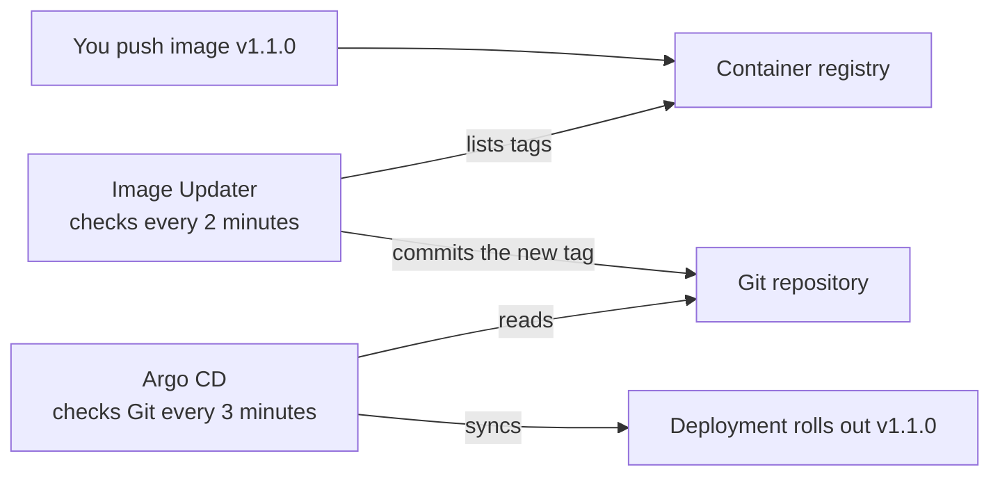
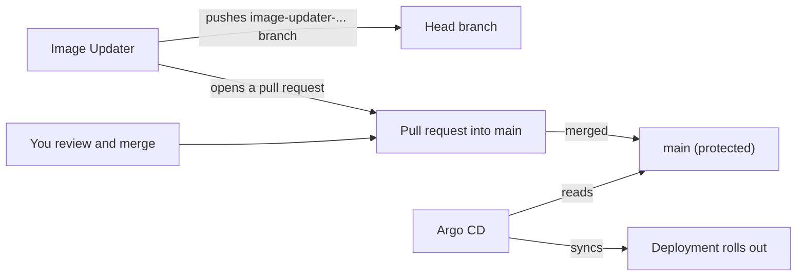

# Lab 03: Image Updater

**Goal:** publish a new image tag and watch it reach the cluster **with no human step**: Argo CD Image Updater finds
the tag, commits the decision to Git, and Argo CD rolls it out. Once for a Helm app and once for a Kustomize app, using
the **default write-back method**, which leaves your chart and overlay files untouched.

Suggested time: 45 minutes to read, 1 hour to repeat. Needs the cluster from
[Lab 01](../01-bootstrap-multi-tenancy/README.md).

> [!NOTE]
>
> **This lab is a captured run.** Image Updater commits to Git, so repeating it needs a Git repository you can push to,
> a token and an image you can push (see [Try it yourself](#try-it-yourself)). The outputs below come from a real run on
> the lab cluster, with a local registry (`argolab-registry:5000`) and a throwaway local Git server in place of Docker Hub
> and GitHub, so the image names in the logs have that prefix. Everything else is unchanged.

> [!WARNING]
>
> **Never practise on a real project or with real credentials.** The updater pushes commits with whatever token you give
> it. Use a throwaway fork, a token that can write to **only that fork** and expires soon, and delete both when you are
> done.

> [!NOTE]
>
> **Versions.** The captured output and the field tables below were produced with Image Updater **1.0.1**, before the
> chart was bumped, and have not been re-run on 1.5.x. **Pull request support starts in Image Updater v1.2.0** (not the app's `v1.2.0`
> image tag used later in this page): from that release the `git` write-back can open a pull request through
> `gitConfig.pullRequest`. Earlier releases, such as 1.0.1 (its CRD has
> no `pullRequest` field), can only commit directly to the target branch, or to a different branch (the `base:target`
> form of `branch`). See [Open a pull request instead of committing](#open-a-pull-request-instead-of-committing).

## Concepts



- **Update strategy.** How Image Updater picks the "newest" tag. Here `semver`: the highest semantic version. The CRD
  lists `semver`, `latest`, `digest` and `name` as examples.
- **Write-back method.** Where the decision is stored. `argocd` (the default when `method` is not set) changes the
  Application in the cluster only, so Git no longer says what runs; this lab does not use it. `git` **commits to Git**,
  which keeps Git the source of truth. `git:secret:<namespace>/<name>` is `git` with credentials read from a Secret.
- **What a `git` write-back writes.** Two choices, compared [below](#two-ways-to-write-back):
  - **The default: an override file.** With no `writeBackTarget`, Image Updater writes a small file called
    `.argocd-source-<application name>.yaml` **next to the application's sources**. Argo CD reads it and applies it on top
    of your chart or overlay. Your own files are never edited. **This is what the lab uses.**
  - **Editing the manifest.** With `writeBackTarget: helmvalues:<file>` or `kustomization`, it changes your
    `values.yaml` or `kustomization.yaml` itself.
- **The `ImageUpdater` resource.** Image Updater 1.x is configured with a custom resource, not with annotations on the
  Applications. One resource names the Applications to watch, the images in them and how to write the change back.

## The resource

[`imageupdater.yaml`](imageupdater.yaml), trimmed:

```yaml
apiVersion: argocd-image-updater.argoproj.io/v1alpha1
kind: ImageUpdater
metadata:
  name: hello
  namespace: argocd
spec:
  namespace: argocd                       # where the Argo CD Applications live
  writeBackConfig:
    method: git:secret:argocd/git-creds   # commit to Git, credentials from this Secret
    gitConfig:
      branch: main
      repository: https://github.com/Xeus-Territory/kubewekend   # use YOUR throwaway fork
      # no writeBackTarget: the default override file is written
  commonUpdateSettings:
    updateStrategy: semver
    ignoreTags: [latest]
  applicationRefs:
    - namePattern: hello-helm
      # (the file repeats the same writeBackConfig for each application)
      images:
        - alias: todo
          imageName: xeusnguyen/kubewekend-todo
          manifestTargets:
            helm:
              name: common.image.repository   # the Helm values that hold the image
              tag: common.image.tag
    - namePattern: hello-kustomize-dev
      images:
        - alias: todo
          imageName: xeusnguyen/kubewekend-todo
          manifestTargets:
            kustomize:
              name: xeusnguyen/kubewekend-todo   # the name exactly as written in `images:`
```

> [!NOTE]
>
> The CRD describes `writeBackTarget` as "required if the write-back method is Git". In Image Updater 1.0.1 it is not:
> leaving it out is what selects the override-file behaviour, and both applications were updated.

Only two of the three apps are listed. **`hello-kustomize-prod` is not tracked**, so it stays on its old tag: a simple
way to see the difference between an environment that follows automatically and one that waits for a reviewed commit.

## Before

Everything runs `v1.0.0`:

```text
hello-helm.kubewekend.local    v1.0.0 | Hello from Kubewekend
hello-dev.kubewekend.local     v1.0.0 | Hello from Kubewekend
hello-prod.kubewekend.local    v1.0.0 | Hello from Kubewekend
```

With only `v1.0.0` in the registry, Image Updater has nothing to do:

```text
Processing results: applications=2 images_considered=2 images_skipped=0 images_updated=0 errors=0
```

## Publish v1.1.0

`v1.1.0` is the same app with a different banner message, built from [`app/`](https://github.com/Xeus-Territory/kubewekend/tree/main/examples/argocd-apps/app):

```bash
docker build -t xeusnguyen/kubewekend-todo:v1.1.0 \
  --build-arg APP_VERSION=v1.1.0 \
  --build-arg APP_MESSAGE="Hello from Kubewekend: rolled out by Image Updater" $REPO/examples/argocd-apps/app
docker push xeusnguyen/kubewekend-todo:v1.1.0
```

## What Image Updater did

Within its next cycle (every two minutes) it found the tag and wrote it back. The log, trimmed to the important parts:

```text
Setting new image to .../xeusnguyen/kubewekend-todo:v1.1.0                      application=argocd/hello-helm
Successfully updated image '...:v1.0.0' to '...:v1.1.0', but pending spec update  application=argocd/hello-helm
Committing 1 parameter update(s) for application hello-helm                     application=argocd/hello-helm
Setting new image to .../xeusnguyen/kubewekend-todo:v1.1.0                      application=argocd/hello-kustomize-dev
Committing 1 parameter update(s) for application hello-kustomize-dev            application=argocd/hello-kustomize-dev
Successfully updated the live application spec                                  application=argocd/hello-helm
Successfully updated the live application spec                                  application=argocd/hello-kustomize-dev
Processing results: applications=2 images_considered=2 images_skipped=0 images_updated=2 errors=0
```

Git has two new commits, authored by the updater:

```text
1205aa7 argocd-image-updater <noreply@argoproj.io>
    build: automatic update of hello-kustomize-dev
3b9589f argocd-image-updater <noreply@argoproj.io>
    build: automatic update of hello-helm
```

The body of each commit says `updates image xeusnguyen/kubewekend-todo tag 'v1.0.0' to 'v1.1.0'`. Each commit **adds one
new file** and touches nothing else. Look in the two source folders (`ls -A` shows hidden files):

```text
hello-helm:
.argocd-source-hello-helm.yaml
Chart.lock
Chart.yaml
.helmignore
values.yaml

hello-kustomize/overlays/dev:
.argocd-source-hello-kustomize-dev.yaml
kustomization.yaml
```

### The Helm override file

`workloads/hello-helm/.argocd-source-hello-helm.yaml`, 8 lines. It sets the two chart values you named in
`manifestTargets.helm`, as Helm parameters:

```yaml
helm:
  parameters:
  - name: common.image.repository
    value: argolab-registry:5000/xeusnguyen/kubewekend-todo
    forcestring: true
  - name: common.image.tag
    value: v1.1.0
    forcestring: true
```

### The Kustomize override file

`workloads/hello-kustomize/overlays/dev/.argocd-source-hello-kustomize-dev.yaml`, 3 lines. It is the same thing as
`kustomize edit set image`:

```yaml
kustomize:
  images:
  - argolab-registry:5000/xeusnguyen/kubewekend-todo=argolab-registry:5000/xeusnguyen/kubewekend-todo:v1.1.0
```

On Docker Hub the image is `xeusnguyen/kubewekend-todo` (no registry prefix).

### Your own files did not change

This is the point of the method. The base files still say the **old** tag, while the new one is live:

```text
hello-helm/values.yaml:                  tag: "v1.0.0"
overlays/dev/kustomization.yaml:         newTag: v1.0.0

live:  hello-helm ...:v1.1.0    hello-dev ...:v1.1.0    hello-prod ...:v1.0.0
```

Argo CD merged the override files on top when it rendered the manifests. The Application object itself did not change
(`spec.source.helm` still holds only `releaseName` and `valueFiles`), and Argo CD reports the running image in
`status.summary.images`.

```text
hello-helm.kubewekend.local    v1.1.0 | Hello from Kubewekend: rolled out by Image Updater
hello-dev.kubewekend.local     v1.1.0 | Hello from Kubewekend: rolled out by Image Updater
hello-prod.kubewekend.local    v1.0.0 | Hello from Kubewekend
```

The whole thing took about 4.5 minutes (256 seconds). Image Updater checks the registry every **2 minutes**, and Argo CD
checks Git every **3 minutes** by default. Both can be tightened (a registry webhook for Image Updater, a Git webhook for
Argo CD).

### The next update is one line

Publishing `v1.2.0` changed the override file and nothing else. Both apps were on `v1.2.0` about 70 seconds after the
push:

```diff
   - name: common.image.tag
-    value: v1.1.0
+    value: v1.2.0
     forcestring: true
```

One small commit per update, one line each: that is easy to review and easy to revert.

## Two ways to write back

| | **Override file** (default, no `writeBackTarget`) | **Edit the manifest** (`writeBackTarget`) |
|---|---|---|
| Setting | Leave `writeBackTarget` out | `helmvalues:<file>` or `kustomization` |
| What lands in Git | A hidden file next to the app: `.argocd-source-<app>.yaml` | A change inside your `values.yaml` or `kustomization.yaml` |
| First update | A new 8-line (Helm) or 3-line (Kustomize) file | A change in your file |
| Later updates | One line | Kustomize: one line. Helm: the whole file is rewritten (see below) |
| Your chart and overlay files | **Never touched.** They keep the tag you wrote | Rewritten by the updater |
| Fits | Any chart or overlay, however large or generated: you only name the values | Charts and overlays where you want the tag visible in the file you read |
| Where the tag lives | Two places: your file (the baseline) and the override file (what runs, wins) | One place |
| Watch out | A reader of `values.yaml` sees an old tag | The Helm diff is noisy |

**Why the override file suits custom charts.** The updater only needs two value names (`common.image.repository` and
`common.image.tag` here). It never parses or rewrites your chart, so a large `values.yaml` full of comments, anchors or
template-generated content is left exactly as you wrote it, and the commit stays tiny.

### The other method: editing the manifest

For comparison, the same run with `writeBackTarget: helmvalues:values.yaml` and `writeBackTarget: kustomization`
(captured earlier on the same cluster). **There are no override files in that case:** the change lives in your manifests.

The Kustomize diff is small. It bumps `newTag`, and it also adds `newName`, because that is what `kustomize edit set
image` does:

```diff
   - name: argolab-registry:5000/xeusnguyen/kubewekend-todo
-    newTag: v1.0.0
+    newTag: v1.1.0
+    newName: argolab-registry:5000/xeusnguyen/kubewekend-todo
```

The Helm diff is noisy. The tag changes as expected, but the updater **rewrites the whole `values.yaml`**: 12 insertions
and 20 deletions for a one-word change, dropping blank lines and re-indenting lists:

```diff
-    tag: "v1.0.0"
+    tag: "v1.1.0"
   containerPorts:
-    - name: http
-      containerPort: 3000
-      protocol: TCP
-
+  - name: http
+    containerPort: 3000
+    protocol: TCP
```

To use it, uncomment the `writeBackTarget` lines in [`imageupdater.yaml`](imageupdater.yaml).

## Undo and pin

The override file is an ordinary file, so you can see what happens when you remove it. With the updater paused (its
controller scaled to zero), deleting the two files in Git and refreshing the applications put both apps back on the tag
in your own files within about five seconds:

```text
now (updater running):                  hello-helm=v1.2.0  hello-dev=v1.2.0  hello-prod=v1.0.0
override files deleted, updater paused: hello-helm=v1.0.0  hello-dev=v1.0.0  hello-prod=v1.0.0
```

Then the updater was resumed, and it wrote both files again within 20 seconds, back to the newest tag:

```text
override files written again after +20s: 6b8d07c argocd-image-updater: build: automatic update of hello-helm
                                         4e07f58 argocd-image-updater: build: automatic update of hello-kustomize-dev
live again:                             hello-helm=v1.2.0  hello-dev=v1.2.0  hello-prod=v1.0.0
```

So **deleting the file does not pin a version**: while an application is listed in the `ImageUpdater` resource, the
updater keeps writing it. To hold an environment on a tag, stop the updater for that application (remove it from
`applicationRefs`, or delete the resource), or narrow which tags are eligible (see `allowTags` and `ignoreTags` in the
[reference](#configuration-reference)). To **promote** a tag to an environment that is not tracked, such as
`hello-kustomize-prod`, change its own `kustomization.yaml` in a normal reviewed commit.

## Open a pull request instead of committing

> [!NOTE]
>
> **Not run in this lab.** The examples in this section come from the official Image Updater documentation (the stable
> line) and are adapted to the lab's apps. They need Image Updater **v1.2.0 or newer**, the first release with `gitConfig.pullRequest` (the 1.0.1
> used for the captures above does not have it). Treat them as a starting point and check the
> [update methods](https://argocd-image-updater.readthedocs.io/en/stable/basics/update-methods/) page for your version.

Everything above pushes straight to the branch Argo CD tracks. That fails when the branch is **protected**: if GitHub
requires a pull request and forbids direct pushes, the updater's commit is rejected. **Pull request mode** keeps the
same `git` write-back but changes the last step: instead of pushing to `main`, the updater

1. pushes the update commit to a **new head branch** it names itself, `image-updater-<targetKey>-<sha256>`, where
   `<targetKey>` is a short hash of the write-back target (repository, branch and target path), and
2. **opens a pull request** from that branch into the base branch you configured.

Nothing changes in the cluster until a person reviews and merges the pull request, and Argo CD then syncs the merged
commit as usual. If a pull request for the same head and base already exists, the updater leaves it alone and does not open
a duplicate. Applications that share the same write-back target reuse the same head branch, which avoids duplicate pull requests.



### Example 1: GitHub, with the default override file

The smallest change from this lab's `imageupdater.yaml` is to add `pullRequest.github` to the `gitConfig`. Keep `branch` as
the **base** branch only:

```yaml
spec:
  namespace: argocd
  writeBackConfig:
    method: git:secret:argocd/git-creds    # a token (PAT or GitHub App), not an SSH key
    gitConfig:
      repository: https://github.com/<you>/<throwaway-fork>.git
      branch: main                         # the BASE branch; no "base:target" form in PR mode
      pullRequest:
        github: {}
```

The pull request then contains the `.argocd-source-<app>.yaml` file, so reviewers see a one-line change. The official
examples set a `writeBackTarget`; leaving it out, as here, relies on PR mode extending the default `git` write-back, which
the docs describe but do not show in an example. Try it on a throwaway repository first.

### Example 2: GitHub, editing the manifest (per-application target)

This is the shape of the official example. The pull request changes your own `values.yaml` or `kustomization.yaml`. A path
that starts with `/` is relative to the repository root. `helmvalues:` takes a values **file**, `kustomization:` takes a
**directory**:

```yaml
spec:
  namespace: argocd
  writeBackConfig:
    method: git:secret:argocd/git-creds
    gitConfig:
      repository: https://github.com/<you>/<throwaway-fork>.git
      branch: main
      pullRequest:
        github: {}
  applicationRefs:
    - namePattern: hello-helm
      writeBackConfig:
        method: git:secret:argocd/git-creds
        gitConfig:
          branch: main
          writeBackTarget: helmvalues:/examples/argocd-apps/workloads/hello-helm/values.yaml
      images:
        - alias: todo
          imageName: xeusnguyen/kubewekend-todo
          manifestTargets:
            helm:
              name: common.image.repository
              tag: common.image.tag
    - namePattern: hello-kustomize-dev
      writeBackConfig:
        method: git:secret:argocd/git-creds
        gitConfig:
          branch: main
          writeBackTarget: kustomization:/examples/argocd-apps/workloads/hello-kustomize/overlays/dev
      images:
        - alias: todo
          imageName: xeusnguyen/kubewekend-todo
          manifestTargets:
            kustomize:
              name: xeusnguyen/kubewekend-todo
```

### Example 3: add labels to every pull request

`pullRequest.labels` puts labels on each pull request the updater opens, for example to drive review rules or a merge
queue:

```yaml
spec:
  writeBackConfig:
    method: git:secret:argocd/git-creds
    gitConfig:
      repository: https://github.com/<you>/<throwaway-fork>.git
      branch: main
      pullRequest:
        github: {}
        labels:
          - image-update
          - automated
```

On GitHub the labels are applied in a follow-up call after the pull request exists. If that call fails, for example because
the token cannot write issues, the updater logs a warning and the pull request is **still created**.

### What to know before you use it

| Topic | Note |
|-------|------|
| Credentials | A bearer token is required: a personal access token or a GitHub App, given through `method: git:secret:<ns>/<name>`. **SSH keys do not work**, because the updater must call the GitHub API. The commits and the pull request are authored as that token's identity |
| Token permissions | Enough to push a branch and open a pull request on that repository. Labels also need permission to write issues. Use a token limited to one throwaway repository, with a short expiry, and check GitHub's current permission names |
| Branch setting | Only the base branch, for example `main`. A value with a colon (`base:target`) together with `pullRequest` is a **validation error** and the resource is not reconciled |
| Title and body | The title is the first line of the Git commit message template and the body is the rest. Defaults: `chore: update images for <namespace>/<appName>` and a short "created automatically by argocd-image-updater" text |
| Other providers | GitLab (`pullRequest.gitlab`), Azure DevOps and Gitea or Forgejo are supported with their own settings. See the update methods page; they are not shown here |
| TLS | Calls to the Git provider's API always verify TLS, even if the repository is registered as `insecure` in Argo CD, because they carry the token. The self-signed Gitea in [lab 00](../00-platform/README.md#practise-locally-with-gitea-and-a-registry-no-github) would need its certificate trusted by Argo CD first, so that setup is not meant for PR mode |
| After an upgrade | The head branch used to be named from the application (`image-updater-<namespace>-<appName>-<sha256>`). Newer releases name it from the write-back target. After upgrading, the first run creates a branch with the new name, and **old pull requests are not closed for you**: close them and delete their branches by hand |
| Latency | Add your review time to the roughly 4.5 minutes seen above. The app stays on the old tag until the pull request is merged and Argo CD has synced |

> [!TIP]
>
> Use pull request mode for environments that are protected, such as production overlays, and direct commits for
> environments you want to follow automatically, such as `dev`. The docs do not say how a per-application
> `writeBackConfig` merges with a `pullRequest` set at the `spec` level, so the safe way to mix both is **two
> `ImageUpdater` resources**: one with `pullRequest` for the protected applications and one without for the rest.

## Break it: an `http://` repository

Image Updater 1.0.1 builds Git credentials from a Secret only for `https://` and `ssh` URLs. With a plain `http://`
repository it finds the new tag and then fails at the last step:

```text
Could not update application spec: could not get creds for repo 'http://argolab-gitea:3000/argolab/kubewekend': unknown repository type
Processing results: applications=2 images_considered=2 images_skipped=0 images_updated=0 errors=2
```

The error does not say "use https", so remember it: `unknown repository type` means the `repository` URL is not
`https://` or `ssh`. GitHub, GitLab and most Git servers are fine.

## Configuration reference

Every field of the `ImageUpdater` resource in version 1.0.1, with the meaning taken from the CRD itself
(`kubectl explain imageupdater.spec --recursive`). **Used here** says whether this lab sets the field. The two
`pullRequest` rows are the exception: they come from the documentation of Image Updater v1.2.0 and newer, not from the 1.0.1 CRD.

### Where settings can be given

`commonUpdateSettings` and `writeBackConfig` can be set at three levels, and the **more specific level wins**:

1. `spec`: the default for everything in the resource
2. `spec.applicationRefs[]`: for the applications that entry selects
3. `spec.applicationRefs[].images[]`: for one image (`commonUpdateSettings` only)

### `spec`

| Field | Meaning | Used here |
|-------|---------|-----------|
| `namespace` (required) | The namespace where the controller looks for Argo CD Applications | Yes (`argocd`) |
| `applicationRefs[]` (required) | Rules that select Applications and say how to update their images | Yes |
| `commonUpdateSettings` | Defaults for update strategy, tag filtering and pull secrets | Yes |
| `writeBackConfig` | Defaults for how and where to write back the change | Yes |

### `writeBackConfig`

| Field | Meaning | Used here |
|-------|---------|-----------|
| `method` (required) | How to write back. Defaults to `argocd` when not set. `git` commits to Git; `git:secret:<ns>/<name>` is `git` with credentials from a Secret | `git:secret:argocd/git-creds` |
| `gitConfig.branch` | Branch to commit to. Required for `git` unless set at the `spec` level | `main` |
| `gitConfig.repository` | Repository URL to commit to. If left out, it is taken from the Application's `spec.source.repoURL` | Yes |
| `gitConfig.writeBackTarget` | The file to change, such as `helmvalues:./helm/values.yaml` or `kustomization:./kustomize/overlays/production`. **Leave it out for the override file** | Omitted (the manifest-editing variant sets it) |
| `gitConfig.pullRequest` | Open a pull request instead of pushing to the branch. Pick the provider inside it: `github: {}`, `gitlab`, and others (see [above](#open-a-pull-request-instead-of-committing)). **Image Updater v1.2.0 and newer; not in the 1.0.1 CRD** | No |
| `gitConfig.pullRequest.labels` | A list of labels to put on every pull or merge request. **v1.2.0 and newer** | No |

`gitConfig` is only valid when `method` is `git` or starts with `git:`.

### `commonUpdateSettings`

| Field | Meaning | Used here |
|-------|---------|-----------|
| `updateStrategy` | How the newest tag is chosen: `semver`, `latest`, `digest`, `name` | `semver` |
| `allowTags` | A regular expression; only matching tags are eligible | No |
| `ignoreTags` | A list of glob-like patterns of tags to ignore | `latest` |
| `forceUpdate` | Whether updates should be forced | No |
| `platforms` | Target platforms to consider, such as `linux/amd64` and `linux/arm64`, when checking for new versions or digests | No |
| `pullSecret` | The pull secret to use for the images, for example `pullsecret:argocd/regcred` | No |

### `applicationRefs[]`: which applications

| Field | Meaning | Used here |
|-------|---------|-----------|
| `namePattern` (required) | A glob pattern for the Application name | Exact names |
| `labelSelectors.matchLabels` | Select Applications by label (`key: value`) | No |
| `labelSelectors.matchExpressions` | Select Applications by label expressions. All requirements are ANDed | No |
| `images[]` (required) | The images to update in the selected Applications | Yes |
| `commonUpdateSettings`, `writeBackConfig` | Override the `spec`-level settings for these Applications | `writeBackConfig` repeated |

> [!TIP]
>
> The CRD says `namePattern` is a glob, so an entry such as `hello-kustomize-*` should cover every Application the
> ApplicationSet generates, and with the override file you do not need a per-application path in `writeBackTarget`. This
> lab only used exact names, so test the glob before relying on it. Label selectors work the same way if the ApplicationSet
> template adds a label.

### `images[]`: which images and where they live

| Field | Meaning | Used here |
|-------|---------|-----------|
| `alias` (required) | A short name for this image. Must be unique within one `applicationRefs` entry | `todo` |
| `imageName` (required) | The image to track: the registry (if not Docker Hub), the name and the initial or current tag. It is what is used to query the registry | Yes |
| `commonUpdateSettings` | Overrides the settings for this one image | No |
| `manifestTargets` | Where the image appears in the manifests. Optional, and only **one** of `helm` or `kustomize` | Yes |

### `manifestTargets`

| Field | Meaning | Used here |
|-------|---------|-----------|
| `helm.name` (required with `helm`) | Dot-separated path to the chart value for the image repository, such as `image.repository` or `frontend.deployment.image.name` | `common.image.repository` |
| `helm.tag` (required with `helm`) | Dot-separated path to the chart value for the tag, such as `image.tag` | `common.image.tag` |
| `helm.spec` | Dot-separated path to **one** value that holds the whole image string (`image/name:1.0`). For charts that take a single `image:` field. When set, the other Helm options are ignored | No |
| `kustomize.name` (required with `kustomize`) | The image name as it appears in the `images:` list of the `kustomization.yaml` | `xeusnguyen/kubewekend-todo` |

For a chart that does not follow the `image.repository` and `image.tag` convention, only the names in
`manifestTargets.helm` change. With the default method nothing in the chart has to change.

## Try it yourself

**No GitHub account, or want zero risk?** Use the local Gitea and registry from
[lab 00](../00-platform/README.md#practise-locally-with-gitea-and-a-registry-no-github): it sets everything up and ends
with exactly this lab, run against containers on your own machine.

Otherwise you need a **throwaway fork** (see [lab 00](../00-platform/README.md#using-your-own-fork-needed-for-one-step-in-lab-2)),
an image repository you can push to, and a Git token that can write to **only that fork**. Do not use your real project.

1. Change `xeusnguyen/kubewekend-todo` to your image everywhere it appears (`workloads/` and `imageupdater.yaml`) and
   push, or keep the public image and only change `repository` in the resource to your fork.
2. Create the credentials. Never commit the token, and give it a short expiry:

   ```bash
   kubectl -n argocd create secret generic git-creds \
     --from-literal=username=<your-github-user> \
     --from-literal=password=<token-limited-to-the-fork>
   ```

3. Apply the resource and follow the log:

   ```bash
   kubectl apply -f $REPO/examples/argocd-apps/labs/03-image-updater/imageupdater.yaml
   kubectl -n argocd logs deploy/argocd-image-updater-controller -f | grep -E 'new image|Committing|images_updated|error'
   ```

4. Build and push `v1.1.0` as shown above, then watch the log, `git pull` in your fork to see the two new
   `.argocd-source-*.yaml` files, and run `hello hello-dev` (the helper from lab 00).

For a private registry add `pullSecret: pullsecret:argocd/regcred` under `commonUpdateSettings`. A self-hosted registry
(like the local one used for the capture, which is plain HTTP) needs an entry under `config.registries` in the Image
Updater values.

## Self-check

- Why does the `git` write-back method keep Git the source of truth, and what would `argocd` do instead?
- After the update, `values.yaml` says `v1.0.0` but `v1.1.0` is running. Where does the running tag come from, and which
  one wins?
- `hello-kustomize-prod` has the same image as `dev`. Why did it not change, and how would you promote the tag to it?
- You delete `.argocd-source-hello-helm.yaml` and the updater is still running. What happens, and how do you really hold
  the app on a tag?
- When would you choose `writeBackTarget` over the override file, and what do you give up?
- Your `main` branch requires pull requests and forbids direct pushes. What does the updater do with the settings in this
  lab, and which single setting changes that?
- In pull request mode, why must `branch` be only the base branch, and what name does the updater give to the branch it
  creates?
- You publish release-candidate tags such as `v1.2.0-rc1` and do not want production-like environments to follow them.
  Which settings in `commonUpdateSettings` would you use to control which tags are eligible?

## Cleanup

```bash
kubectl -n argocd delete imageupdater hello
kubectl -n argocd delete secret git-creds
```

In your fork, remove the files the updater created (`git rm` the two `.argocd-source-*.yaml` files), then delete the token
you made for this lab.

Next: [Lab 04: argocd-agent](../04-argocd-agent/README.md).
