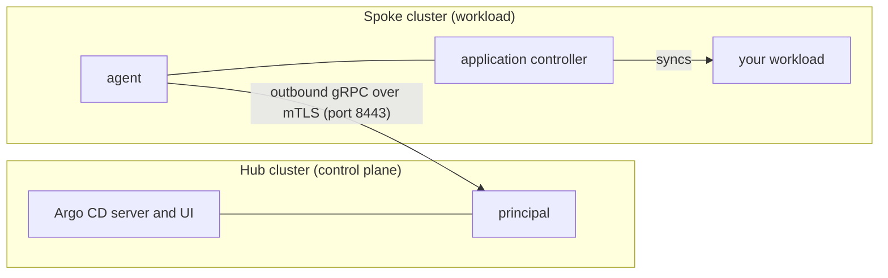

# Lab 04: argocd-agent

**Goal:** manage a second cluster from a first one **without exposing the second cluster's Kubernetes API**. A small agent
on the second cluster connects **out** to the first, pulls its desired state and reports back.

Suggested time: 1.5 to 2 hours. This lab uses its own two Kind clusters, so it does not need labs 0 to 3.

## Concepts

Classic multi-cluster Argo CD gives one central Argo CD the credentials and the network path to every cluster's API
server. [argocd-agent](https://github.com/argoproj-labs/argocd-agent) flips the direction:



| | Hub | Spoke |
|---|-----|-------|
| Argo CD parts | API server and UI, repo server, Redis, Dex, notifications | **Application controller**, repo server, Redis |
| argocd-agent part | **principal**: a gRPC server that agents connect to | **agent**: connects to the principal |
| Does the real syncing | No: there is no application controller on the hub | Yes: the controller runs next to the workloads |
| Needs to be reachable | The principal port, from the spoke | **Nothing**: the spoke only makes outbound connections |

- **Pull model.** The hub stores the desired state. The agent pulls it and the spoke's own controller applies it.
- **mTLS.** The agent proves who it is with a client certificate whose name is the agent's name.
- **Managed mode** (this lab). The hub owns the Applications; the spoke runs what it is given and reverts local edits.
  **Autonomous mode** is the other way round: the spoke owns its Applications and the hub only observes them (see
  [what this lab does not cover](#what-this-lab-does-not-cover)).

> [!TIP]
>
> Step 3 and step 4 issue certificates with `argocd-agentctl pki`. If certificate authorities, SANs and client
> certificates are new to you, do [lab 05: PKI and mTLS with OpenSSL](../05-pki-mtls/README.md) first. It builds the same
> pieces by hand, needs no cluster, and shows the error each mistake produces, so the certificate steps here read as a
> handful of commands you already understand.

## Steps

**0. Tools and names.**

Install `kind`, `kubectl` and `argocd-agentctl`, the project's command line tool for certificates and agents. Pick the
download for your system from the [releases page](https://github.com/argoproj-labs/argocd-agent/releases):

```bash
export HUB=hub SPOKE=spoke-1 AGENT=spoke-1 NS=argocd RELEASE=v0.11.0
curl -fsSL -o argocd-agentctl "https://github.com/argoproj-labs/argocd-agent/releases/download/$RELEASE/argocd-agentctl-linux-amd64"
chmod +x argocd-agentctl && sudo mv argocd-agentctl /usr/local/bin/
argocd-agentctl version

cd "$(git rev-parse --show-toplevel)/examples/argocd-apps/labs/04-argocd-agent"   # guestbook.yaml lives here
```

The Argo CD command line (`argocd`) is used in steps 5 and 7.

> [!NOTE]
>
> Two Kind clusters need two sets of inotify instances. If creating the second cluster fails with
> `could not find a log line that matches "Reached target .*Multi-User System.*"`, the host limit is too low
> (the default is often 128). Raise it: `sudo sysctl fs.inotify.max_user_instances=512`.

**1. Create the two clusters.**

Different pod and service ranges keep the two clusters from overlapping. Both Kind nodes join the same Docker network,
which is how the spoke will reach the hub.

```bash
cat <<EOF | kind create cluster --name $HUB --config=-
kind: Cluster
apiVersion: kind.x-k8s.io/v1alpha4
name: $HUB
networking:
  podSubnet: "10.245.0.0/16"
  serviceSubnet: "10.97.0.0/16"
nodes:
  - role: control-plane
    image: kindest/node:v1.36.4
EOF

cat <<EOF | kind create cluster --name $SPOKE --config=-
kind: Cluster
apiVersion: kind.x-k8s.io/v1alpha4
name: $SPOKE
networking:
  podSubnet: "10.246.0.0/16"
  serviceSubnet: "10.98.0.0/16"
nodes:
  - role: control-plane
    image: kindest/node:v1.36.4
EOF

kubectl create namespace $NS --context kind-$HUB
kubectl create namespace $NS --context kind-$SPOKE
```

**2. Hub: Argo CD, the principal flavour.**

The project ships a kustomization that installs Argo CD **without** the application controller and the ApplicationSet
controller. Server-side apply is required because the manifests are large.

```bash
kubectl apply -n $NS --server-side --context kind-$HUB \
  -k "https://github.com/argoproj-labs/argocd-agent/install/kubernetes/argo-cd/principal?ref=$RELEASE"
```

> [!NOTE]
>
> The kustomization takes Argo CD from its `stable` release, so the Argo CD version is whatever `stable` is today. In
> the test run it was `v3.6.2` (agent v0.11 supports the Argo CD 3.6 stream).

Two settings on the hub's Argo CD:

```bash
kubectl patch configmap argocd-cmd-params-cm -n $NS --context kind-$HUB \
  --patch '{"data":{"application.namespaces":"*","redis.server":"argocd-agent-redis-proxy:6379"}}'
kubectl rollout restart deployment argocd-server -n $NS --context kind-$HUB
for d in argocd-server argocd-repo-server argocd-redis; do
  kubectl rollout status deploy/$d -n $NS --context kind-$HUB --timeout=240s
done
```

- `application.namespaces: "*"` lets Applications live in any namespace.
- `redis.server` makes the API server read live data (resource trees) through the principal's **Redis proxy**, which
  fetches it from the spoke on demand. Without it the hub shows an app's sync status but fails to show its resources
  with `cache: key is missing`.

**3. Hub: certificates and the principal.**

```bash
argocd-agentctl pki init --principal-context kind-$HUB --principal-namespace $NS

kubectl apply -n $NS --context kind-$HUB \
  -k "https://github.com/argoproj-labs/argocd-agent/install/kubernetes/principal?ref=$RELEASE"
```

The principal listens on port 8443. A NetworkPolicy installed with it blocks traffic from outside the hub, so allow the
agent's connection. Then bind to all interfaces, turn on destination-based mapping (an Application names its agent with
`destination.name`) and expose the principal as a NodePort:

```bash
kubectl patch networkpolicy argocd-agent-redis-proxy -n $NS --context kind-$HUB --type=json \
  -p='[{"op":"add","path":"/spec/ingress/-","value":{"ports":[{"protocol":"TCP","port":8443}]}}]'

kubectl patch configmap argocd-agent-params -n $NS --context kind-$HUB --patch "{\"data\":{
  \"principal.allowed-namespaces\":\"$AGENT\",
  \"principal.destination-based-mapping\":\"true\",
  \"principal.listen.host\":\"0.0.0.0\"}}"

kubectl patch svc argocd-agent-principal -n $NS --context kind-$HUB --patch '{"spec":{"type":"NodePort"}}'
```

The principal's server certificate must name the address the agent will use: the hub node's address on the Docker
network and the NodePort. The resource proxy (how the hub's Argo CD reaches the spoke's live data) gets its own:

```bash
HUB_IP=$(kubectl get node $HUB-control-plane --context kind-$HUB -o jsonpath='{.status.addresses[?(@.type=="InternalIP")].address}')
NODEPORT=$(kubectl get svc argocd-agent-principal -n $NS --context kind-$HUB -o jsonpath='{.spec.ports[0].nodePort}')
RP_IP=$(kubectl get svc argocd-agent-resource-proxy -n $NS --context kind-$HUB -o jsonpath='{.spec.clusterIP}')
echo "hub node: $HUB_IP, principal NodePort: $NODEPORT"

argocd-agentctl pki issue principal --principal-context kind-$HUB --principal-namespace $NS \
  --ip 127.0.0.1,$HUB_IP --dns localhost,argocd-agent-principal.$NS.svc.cluster.local --upsert
argocd-agentctl pki issue resource-proxy --principal-context kind-$HUB --principal-namespace $NS \
  --ip 127.0.0.1,$RP_IP --dns localhost,argocd-agent-resource-proxy.$NS.svc.cluster.local --upsert
argocd-agentctl jwt create-key --principal-context kind-$HUB --principal-namespace $NS --upsert

kubectl rollout restart deployment argocd-agent-principal -n $NS --context kind-$HUB
kubectl rollout status deployment argocd-agent-principal -n $NS --context kind-$HUB --timeout=180s
```

```text
hub node: 172.18.0.7, principal NodePort: 30435
```

> [!WARNING]
>
> `argocd-agentctl pki` is meant for evaluation. It keeps the certificate authority in a Secret on the hub. For anything
> real, issue certificates with your own PKI (cert-manager, Vault, SPIRE).

**4. Spoke: Argo CD (managed flavour), then the agent.**

The managed flavour is Argo CD with the application controller and no API server or UI:

```bash
kubectl apply -n $NS --server-side --context kind-$SPOKE \
  -k "https://github.com/argoproj-labs/argocd-agent/install/kubernetes/argo-cd/agent-managed?ref=$RELEASE"
```

Register the agent on the hub, give it a client certificate on the spoke, and create the agent's namespace on the hub:

```bash
argocd-agentctl agent create $AGENT --principal-context kind-$HUB --principal-namespace $NS \
  --resource-proxy-server argocd-agent-resource-proxy.$NS.svc.cluster.local:9090
argocd-agentctl pki issue agent $AGENT --principal-context kind-$HUB \
  --agent-context kind-$SPOKE --agent-namespace $NS --upsert
kubectl create namespace $AGENT --context kind-$HUB
```

Deploy the agent and tell it where the principal is, which mode to use and how to authenticate:

```bash
kubectl apply -n $NS --context kind-$SPOKE \
  -k "https://github.com/argoproj-labs/argocd-agent/install/kubernetes/agent?ref=$RELEASE"

kubectl patch configmap argocd-agent-params -n $NS --context kind-$SPOKE --patch "{\"data\":{
  \"agent.server.address\":\"$HUB_IP\",
  \"agent.server.port\":\"$NODEPORT\",
  \"agent.mode\":\"managed\",
  \"agent.creds\":\"mtls:any\",
  \"agent.destination-based-mapping\":\"true\",
  \"agent.create-namespace\":\"true\"}}"

kubectl rollout restart deployment argocd-agent-agent -n $NS --context kind-$SPOKE
kubectl rollout status deployment argocd-agent-agent -n $NS --context kind-$SPOKE --timeout=180s
```

**5. Check that the two sides found each other.**

From the spoke: the agent authenticated and connected. (The loop waits a few seconds for the new pod, and selects pods by
label because the old pod can still be terminating, which makes `kubectl logs deployment/...` pick the wrong one.)

```bash
for i in $(seq 1 20); do
  kubectl logs -n $NS -l app.kubernetes.io/name=argocd-agent-agent --context kind-$SPOKE --tail=200 \
    | grep -E 'Authentication successful|Connected to' && break
  sleep 3
done
```

```text
time="2026-11-24T08:14:21Z" level=info msg="Authentication successful" module=Connector
time="2026-11-24T08:14:21Z" level=info msg="Connected to argocd-agent-0.11.0" module=Connector
```

From the hub: the principal knows the agent, and the hub's Argo CD lists it as a cluster.

```bash
argocd-agentctl agent list --principal-context kind-$HUB --principal-namespace $NS

PW=$(kubectl -n $NS --context kind-$HUB get secret argocd-initial-admin-secret -o jsonpath='{.data.password}' | base64 -d)
kubectl -n $NS --context kind-$HUB port-forward svc/argocd-server 8080:443 > /dev/null 2>&1 &
PF=$!
sleep 5
argocd login localhost:8080 --insecure --username admin --password "$PW"
argocd cluster list
```

```text
spoke-1
SERVER                                                                               NAME        VERSION  STATUS      MESSAGE
https://argocd-agent-resource-proxy.argocd.svc.cluster.local:9090?agentName=spoke-1  spoke-1              Successful  Agent: 'spoke-1' is connected with principal
https://kubernetes.default.svc                                                       in-cluster  1.36.4   Successful
```

The hub's `default` AppProject was also pushed to the spoke automatically:

```bash
kubectl get appprojects -n $NS --context kind-$SPOKE
```

> [!NOTE]
>
> On the first connection the agent logs a few lines at `error` level, such as `Cannot manage appProject that is
> already managed` and a GPG key message, and the principal logs a deprecation warning about the mTLS setting. They come
> from the first resynchronisation. In the test run nothing failed because of them.

**6. Deploy from the hub to the spoke.**

[`guestbook.yaml`](guestbook.yaml) is an ordinary Application. The only unusual part is the destination: the agent's
**name**, not a cluster address.

```yaml
  destination:
    name: spoke-1
    namespace: guestbook
```

```bash
kubectl apply -f guestbook.yaml --context kind-$HUB
kubectl wait --for=jsonpath='{.status.sync.status}'=Synced application/guestbook -n $NS --context kind-$HUB --timeout=240s
kubectl wait --for=jsonpath='{.status.health.status}'=Healthy application/guestbook -n $NS --context kind-$HUB --timeout=240s
```

Now compare the two clusters:

```bash
echo "hub destination:   $(kubectl get application guestbook -n $NS --context kind-$HUB -o jsonpath='{.spec.destination}')"
echo "spoke destination: $(kubectl get application guestbook -n $NS --context kind-$SPOKE -o jsonpath='{.spec.destination}')"
kubectl get pods -n guestbook --context kind-$SPOKE
! kubectl get namespace guestbook --context kind-$HUB
```

```text
hub destination:   {"name":"spoke-1","namespace":"guestbook"}
spoke destination: {"name":"in-cluster","namespace":"guestbook"}
NAME                            READY   STATUS    RESTARTS   AGE
guestbook-ui-5d6468fd55-m89rd   1/1     Running   0          30s
Error from server (NotFound): namespaces "guestbook" not found
```

- The **hub** keeps `spoke-1` as the destination: it is how it routes the Application.
- The **spoke** received the same Application with the destination rewritten to `in-cluster`: for the spoke's own
  controller it is simply a local deployment.
- The pods exist only on the spoke. The hub never ran them and has no `guestbook` namespace.

Where does each component run?

```bash
echo "hub:   $(kubectl get pods -n $NS --context kind-$HUB -o name | sed 's|pod/||' | tr '\n' ' ')"
echo "spoke: $(kubectl get pods -n $NS --context kind-$SPOKE -o name | sed 's|pod/||' | tr '\n' ' ')"
```

```text
hub:   argocd-agent-principal-764df66859-cdtz5 argocd-dex-server-bf7db8f94-p797s argocd-notifications-controller-7fb458797f-rngkn argocd-redis-765d647874-dlxms argocd-repo-server-5c85959b9d-kb9qs argocd-server-cdcdf5448-hksc8
spoke: argocd-agent-agent-8fd9466cf-7xhn8 argocd-application-controller-0 argocd-redis-765d647874-58fmq argocd-repo-server-5c85959b9d-stsmg
```

No application controller on the hub, no API server on the spoke.

**7. The hub can see into the spoke.**

The hub's Argo CD shows live data that lives on the spoke. It asks the spoke through the connection the agent opened, so
the spoke's API server stays private.

```bash
argocd app get guestbook
```

```text
Name:               argocd/guestbook
Project:            default
Server:             spoke-1
Namespace:          guestbook
URL:                https://localhost:8080/applications/guestbook
Source:
- Repo:             https://github.com/argoproj/argocd-example-apps
  Target:           HEAD
  Path:             guestbook
SyncWindow:         Sync Allowed
Sync Policy:        Automated (Prune)
Sync Status:        Synced to HEAD (8088f4c)
Health Status:      Healthy

GROUP  KIND        NAMESPACE  NAME          STATUS  HEALTH   HOOK  MESSAGE
apps   Deployment  guestbook  guestbook-ui  Synced  Healthy        deployment.apps/guestbook-ui unchanged
       Service     guestbook  guestbook-ui  Synced  Healthy
```

Pod logs are different: they need one more permission, because the agent's default role cannot read `pods/log`. Without
it the principal logs `pods "..." is forbidden: User "system:serviceaccount:argocd:argocd-agent-agent" cannot get resource
"pods/log"`. Grant exactly that on the spoke:

```bash
kubectl patch clusterrole argocd-agent-agent --context kind-$SPOKE --type=json \
  -p='[{"op":"add","path":"/rules/-","value":{"apiGroups":[""],"resources":["pods/log"],"verbs":["get"]}}]'
POD=$(kubectl get pod -n guestbook --context kind-$SPOKE -l app=guestbook-ui -o jsonpath='{.items[0].metadata.name}')
argocd app logs guestbook --kind Pod --name $POD --tail 3
```

```text
[Tue Nov 24 08:15:05.051332 2026] [mpm_prefork:notice] [pid 1] AH00163: Apache/2.4.38 (Debian) PHP/7.4.33 configured -- resuming normal operations
[Tue Nov 24 08:15:05.051368 2026] [core:notice] [pid 1] AH00094: Command line: 'apache2 -D FOREGROUND'
```

## Break it

**1. Edit a managed Application on the spoke.** In managed mode the hub owns the spec. Change it on the spoke:

```bash
kubectl -n $NS --context kind-$SPOKE patch application guestbook --type merge -p '{"spec":{"source":{"path":"helm-guestbook"}}}'
for i in $(seq 1 10); do
  echo "t+$((i*5))s path=$(kubectl -n $NS --context kind-$SPOKE get application guestbook -o jsonpath='{.spec.source.path}') deployments=[$(kubectl get deploy -n guestbook --context kind-$SPOKE --no-headers | awk '{printf "%s ", $1}')]"
  sleep 5
done
```

```text
t+5s path=guestbook deployments=[guestbook-ui ]
t+10s path=guestbook deployments=[guestbook-helm-guestbook guestbook-ui ]
t+15s path=guestbook deployments=[guestbook-helm-guestbook guestbook-ui ]
t+20s path=guestbook deployments=[guestbook-helm-guestbook guestbook-ui ]
t+25s path=guestbook deployments=[guestbook-helm-guestbook guestbook-ui ]
t+30s path=guestbook deployments=[guestbook-helm-guestbook guestbook-ui ]
t+35s path=guestbook deployments=[guestbook-helm-guestbook guestbook-ui ]
t+40s path=guestbook deployments=[guestbook-ui ]
t+45s path=guestbook deployments=[guestbook-ui ]
t+50s path=guestbook deployments=[guestbook-ui ]
```

Read it in two parts:

- The **spec** was back to `path=guestbook` at the very first reading: the agent reverted the edit within five seconds, so the
  local edit cannot stick.
- The edit still had a **side effect**. The spoke's own controller had already synced the edited path once, so a stray
  `guestbook-helm-guestbook` Deployment appeared and stayed for about 30 seconds, until `prune` removed it.

> [!TIP]
>
> Without `prune` that stray Deployment would stay until someone deletes it. That is what happened in the first attempt of
> this experiment, before the Application had `prune` and `selfHeal`.

**2. Stop the principal.** The spoke works from a local copy of the desired state, so what runs keeps running, and the
hub's new Applications wait.

```bash
kubectl scale deploy argocd-agent-principal -n $NS --context kind-$HUB --replicas=0
kubectl rollout status deploy/argocd-agent-principal -n $NS --context kind-$HUB --timeout=60s
sleep 15
kubectl get pods -n guestbook --context kind-$SPOKE
```

The guestbook pod is still `Running`. Create a second Application on the hub while the principal is down:

```bash
sed 's/name: guestbook$/name: guestbook-2/; s/namespace: guestbook$/namespace: guestbook-2/' guestbook.yaml \
  | kubectl apply -f - --context kind-$HUB
sleep 20
! kubectl get application guestbook-2 -n $NS --context kind-$SPOKE
```

```text
Error from server (NotFound): applications.argoproj.io "guestbook-2" not found
```

Bring the principal back and measure how long the spoke takes to catch up:

```bash
kubectl scale deploy argocd-agent-principal -n $NS --context kind-$HUB --replicas=1
timeout 300 bash -c "until kubectl get application guestbook-2 -n $NS --context kind-$SPOKE >/dev/null 2>&1; do sleep 3; done"
kubectl wait --for=jsonpath='{.status.health.status}'=Healthy application/guestbook-2 -n $NS --context kind-$SPOKE --timeout=300s
kubectl logs -n $NS -l app.kubernetes.io/name=argocd-agent-agent --context kind-$SPOKE --tail=200 | grep -E 'Authentication successful|Connected to'
```

In one test run `guestbook-2` was `Synced` and `Healthy` on the spoke **104 seconds** after the principal came back. Most of
that is the agent's retry backoff: it had been failing to connect for a while, so it waits before the next attempt.

> [!NOTE]
>
> The `sed` line changes both the Application name and its destination namespace, so the second app does not collide with
> the first.

## Self-check

- Which side opens the connection, and what does that mean for firewalls in front of the spoke?
- The hub has no application controller. Who applies the manifests to the spoke?
- Why does the same Application show `destination.name: spoke-1` on the hub and `in-cluster` on the spoke?
- With the principal stopped for ten minutes, what keeps working on the spoke and what does not?
- `redis.server` was not set on the hub. What would you see, and why?

## What this lab does not cover

- **Autonomous mode**, where the spoke owns its Applications and the hub only observes them. See the upstream
  [agent modes](https://argocd-agent.readthedocs.io/latest/concepts/agent-modes/) page. It uses a different Argo CD
  flavour on the spoke (`agent-autonomous`) and `agent.mode: autonomous`. This lab was not run in that mode.
- **Private Git repositories** on managed agents: repository Secrets live on the hub with a `project` field and are
  distributed to the agents the AppProject matches. See the upstream repository guide.
- **High availability.** The principal has no HA mode yet, and `argocd-agentctl pki` is not for production.

## Troubleshooting

| Symptom | Cause | Fix |
|---------|-------|-----|
| Creating the second Kind cluster fails with `could not find a log line that matches ... Multi-User System` | Host inotify limit | `sudo sysctl fs.inotify.max_user_instances=512` |
| The agent logs `connection timed out` to `<ip>:<port>` | Wrong address, or the NetworkPolicy blocks 8443 | Recheck `HUB_IP` and `NODEPORT`; redo the NetworkPolicy patch in step 3 |
| The hub shows the app but `argocd app get` says `cache: key is missing` | The hub's API server is not reading through the Redis proxy | Set `redis.server` and restart `argocd-server` (step 2) |
| `argocd app logs` is empty and the principal logs `cannot get resource "pods/log"` | The agent's role cannot read logs | Grant `pods/log` (step 7) |
| `server.secretkey is missing` in an Application's conditions on the spoke | Spoke Argo CD has no secret key (from the upstream guide, not seen in this run) | Patch `argocd-secret` with a random `server.secretkey` |

## Cleanup

```bash
kill $PF
kind delete cluster --name $HUB
kind delete cluster --name $SPOKE
```
