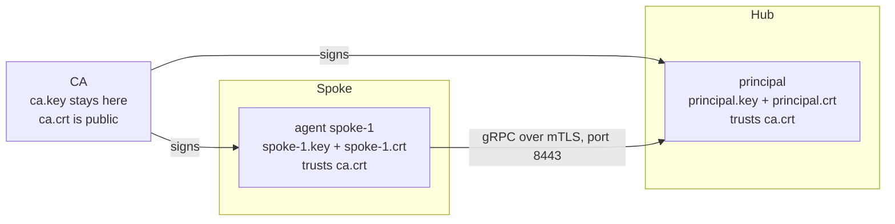
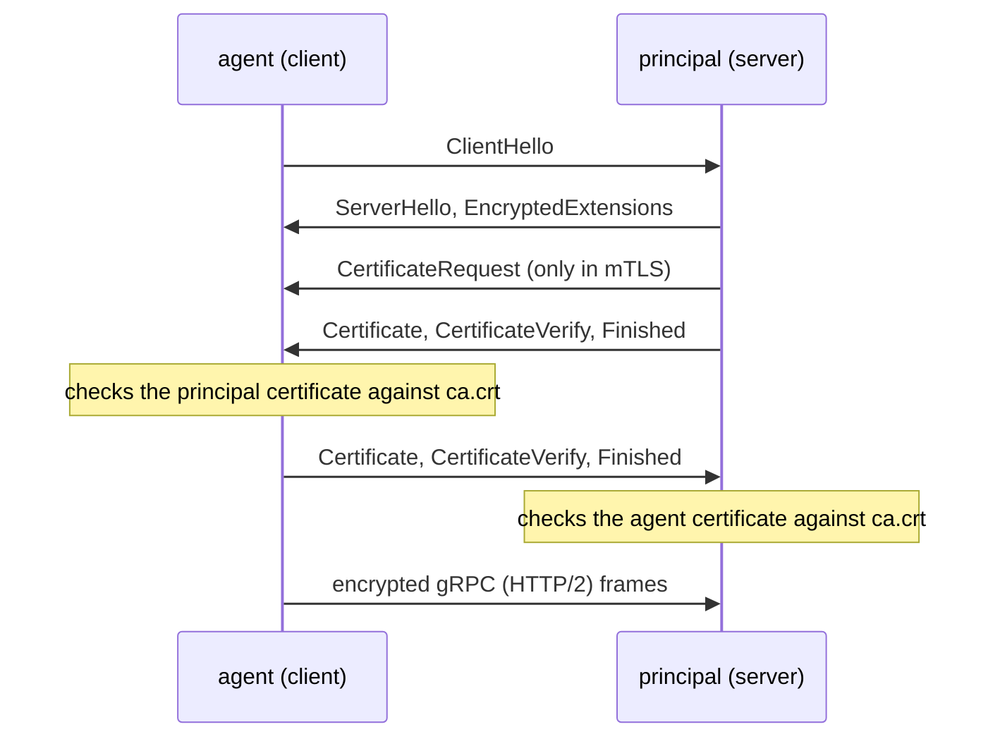

# Lab 05: PKI and mTLS with OpenSSL

**Goal:** build a small public key infrastructure (PKI) by hand and use it for **mutual TLS (mTLS)**, so that the
`argocd-agentctl pki ...` commands in [lab 04](../04-argocd-agent/README.md) stop being a black box. You will create a
certificate authority, issue a server certificate and a client certificate, connect with and without them, and break each
piece on purpose to see the error it produces.

Suggested time: 1 hour. **No cluster, no Docker, no Argo CD.** Everything runs on `localhost` with `openssl`, so it works
before or after lab 04. If mTLS is new to you, do this lab first: lab 04's certificate step then reads as five lines you
already understand.

> [!NOTE]
>
> The names in this lab follow lab 04: the **principal** is the server (on the hub), the **agent** `spoke-1` is the client
> (on the spoke), and the connection is gRPC over port `8443`. Nothing here talks to Argo CD.

## Concepts

TLS does three jobs, and mTLS adds a fourth:

| Job | How | Who proves what |
|-----|-----|-----------------|
| **Encrypt** the traffic | Both sides agree a session key during the handshake | nobody: it is just secrecy |
| **Authenticate the server** | The server sends a **certificate**; the client checks it | "I am `principal.hub.local`" |
| **Authenticate the client** (**mTLS**) | The server asks for a certificate too, and checks it | "I am `spoke-1`" |
| **Keep the proof honest** | Each side signs part of the handshake with its **private key** | only the real owner can answer |

The pieces, from the bottom up:

- A **key pair** is a private key (you keep it) and a public key (anyone may have it). What the private key signs, the
  public key can verify (you will do this in step 1).
- A **certificate** is a public key plus a name, a validity period and what it may be used for, **signed by a certificate
  authority (CA)**. It says: "this CA vouches that this public key belongs to this name".
- A **CA** is a key pair whose certificate everyone in your system has agreed to trust. That certificate is the **trust
  anchor**. Whoever holds the CA's *private* key can mint identities, so it is the one secret that matters most.
- A **chain** is a leaf certificate, optionally intermediate CAs, and the root. A peer is accepted when the chain leads to a
  trust anchor it already has.
- A **CSR** (certificate signing request) is how you ask a CA for a certificate: you generate the key pair yourself and send
  only the public key and the name you want. **Private keys never travel.**



The handshake you will reproduce (TLS 1.3, message names from a real capture in step 6):



gRPC is HTTP/2 carried over TLS, so everything you build here is exactly the layer under lab 04's gRPC connection.

## Steps

**0. Tools and a work folder.**

You need `openssl` 3.x. This page was run with OpenSSL 3.0.13 on Linux. (macOS ships LibreSSL, which behaves differently;
use an OpenSSL 3 build instead. That was not tested here.) Keep the keys **outside any Git repository**:

```bash
openssl version
export LAB=$HOME/pki-lab && mkdir -p $LAB && cd $LAB
ss -ltn | grep ':8443 ' || echo "port 8443 is free"
```

```text
OpenSSL 3.0.13 30 Jan 2024 (Library: OpenSSL 3.0.13 30 Jan 2024)
port 8443 is free
```

If something already listens on 8443, use another port everywhere below.

The client checks in this lab all go through one small helper, so each command stays short. It connects to the server on
`localhost`, sends one line, waits a second to read any error the server sends back, and hides a few noisy lines:

```bash
tlsc() {
  (echo ping; sleep 1) | openssl s_client -connect 127.0.0.1:8443 -servername principal.hub.local \
    -brief -verify_return_error "$@" 2>&1 \
    | grep -vE 'Requested Signature|Hash used|Signature type|Server Temp|Ciphersuite'
}
```

`-verify_return_error` matters: without it OpenSSL prints a verification error and **carries on** with the connection
anyway.

**1. A key pair, and what it can do.**

```bash
openssl genpkey -algorithm EC -pkeyopt ec_paramgen_curve:P-256 -out demo.key
openssl pkey -in demo.key -pubout -out demo.pub

echo "hello from the agent" > msg.txt
openssl dgst -sha256 -sign demo.key -out msg.sig msg.txt
openssl dgst -sha256 -verify demo.pub -signature msg.sig msg.txt

echo "hello from the agent!" > msg2.txt
openssl dgst -sha256 -verify demo.pub -signature msg.sig msg2.txt
```

```text
Verified OK
Verification failure
```

The private key signed the message and the public key proved it. Change one character and the proof breaks. This is the
only trick a certificate relies on, and it is also all that a bare signing key is: lab 04's `argocd-agentctl jwt
create-key` makes a key like this one, with **no certificate and no name** attached. (How argocd-agent uses it is not
covered here.)

`demo.pub` is safe to share. `demo.key` is not:

```bash
cat demo.pub
```

```text
-----BEGIN PUBLIC KEY-----
MFkwEwYHKoZIzj0CAQYIKoZIzj0DAQcDQgAEgQDBa7fopoVc6BrrhzIdyZ7hS7dj
lyFZD3ktcPc/0dZQTW9DuJeeNA4tVfi7/Z4Bz9Ey7NE1cTqy1rHx9Hd5gQ==
-----END PUBLIC KEY-----
```

(Your key differs: it is random.) The lab uses elliptic-curve keys (P-256) because they are small and fast. For RSA, replace
the key command with `openssl genpkey -algorithm RSA -pkeyopt rsa_keygen_bits:3072`; nothing else changes.

**2. Create the certificate authority.**

```bash
openssl genpkey -algorithm EC -pkeyopt ec_paramgen_curve:P-256 -out ca.key
chmod 600 ca.key

openssl req -x509 -new -key ca.key -sha256 -days 3650 -subj "/CN=Kubewekend Lab CA" \
  -addext "basicConstraints=critical,CA:TRUE" \
  -addext "keyUsage=critical,keyCertSign,cRLSign" \
  -out ca.crt

openssl x509 -in ca.crt -noout -subject -issuer -dates -ext basicConstraints,keyUsage
```

```text
subject=CN = Kubewekend Lab CA
issuer=CN = Kubewekend Lab CA
notBefore=Nov 25 06:10:17 2026 GMT
notAfter=Nov 22 06:10:17 2036 GMT
X509v3 Basic Constraints: critical
    CA:TRUE
X509v3 Key Usage: critical
    Certificate Sign, CRL Sign
```

Read it: the **subject equals the issuer**, so the CA signed itself. That is what a root is: nobody above it vouches for
it, so everyone must be given `ca.crt` out of band. `CA:TRUE` and `keyCertSign` are what allow it to sign other
certificates. A leaf certificate has neither.

This is the "`pki init`" step of lab 04. In real life `ca.key` lives offline or in a vault. Anyone who copies it can issue
a valid `spoke-1`.

**3. Issue the server certificate (the principal).**

Three moves: the principal makes its own key, asks for a certificate with a CSR, and the CA signs it.

```bash
openssl genpkey -algorithm EC -pkeyopt ec_paramgen_curve:P-256 -out principal.key
openssl req -new -key principal.key -subj "/CN=principal" -out principal.csr

cat > principal.ext <<'EOF'
basicConstraints=critical,CA:FALSE
keyUsage=critical,digitalSignature
extendedKeyUsage=serverAuth
subjectAltName=DNS:principal.hub.local,DNS:localhost,IP:127.0.0.1
EOF

openssl x509 -req -in principal.csr -CA ca.crt -CAkey ca.key -CAcreateserial \
  -days 90 -sha256 -extfile principal.ext -out principal.crt

openssl x509 -in principal.crt -noout -subject -issuer -dates -ext subjectAltName,extendedKeyUsage
```

```text
subject=CN = principal
issuer=CN = Kubewekend Lab CA
notBefore=Nov 25 06:10:17 2026 GMT
notAfter=Feb 23 06:10:17 2027 GMT
X509v3 Extended Key Usage: 
    TLS Web Server Authentication
X509v3 Subject Alternative Name: 
    DNS:principal.hub.local, DNS:localhost, IP Address:127.0.0.1
```

What each field does:

| Field | Meaning | If it is wrong |
|-------|---------|----------------|
| `issuer` | Which CA signed it | The client cannot find a path to its trust anchor |
| **Subject Alternative Name** (SAN) | The DNS names and IP addresses this certificate is valid for | The client rejects it with a **hostname or IP mismatch** |
| `extendedKeyUsage` | What the certificate may be used for (`serverAuth` here) | A server certificate cannot be used as a client certificate (step 6) |
| `basicConstraints CA:FALSE` | It cannot sign other certificates | A stolen leaf cannot mint new identities |
| `notAfter` | Expiry | The client rejects it, then everything stops (step 4) |

The SAN is why lab 04's `pki issue principal` takes `--ip` and `--dns`: the agent connects to an address, and that address
**must** be in the certificate. The common name (`CN`) is not used for this check.

> [!WARNING]
>
> `openssl x509 -req` **ignores the extensions inside the CSR**. Without `-extfile` you get a certificate with no SAN and no
> key usage at all (the output of `openssl x509 -ext subjectAltName` is `No extensions in certificate`), and clients will
> reject it. Always pass the extensions on the signing side, because a CA should decide them, not the requester.

Check the chain, then check that the certificate and key belong together (their public keys must hash the same):

```bash
openssl verify -CAfile ca.crt principal.crt
openssl verify principal.crt

openssl x509 -in principal.crt -noout -pubkey | openssl sha256
openssl pkey -in principal.key -pubout | openssl sha256
```

```text
principal.crt: OK
CN = principal
error 20 at 0 depth lookup: unable to get local issuer certificate
error principal.crt: verification failed
SHA2-256(stdin)= 17789d60f106e6fa879e2bba4319bfe039fea92b69084b0ab933f3610826fc24
SHA2-256(stdin)= 17789d60f106e6fa879e2bba4319bfe039fea92b69084b0ab933f3610826fc24
```

Without the CA certificate the same file is not trusted. **Trust is a decision you make by choosing which CA certificates
to hand out**, not a property of the certificate.

**4. One-way TLS: the client verifies the server.**

Open **two terminals**. In terminal 2, run `cd $HOME/pki-lab` and define the `tlsc` function from step 0 again (shell
functions are not shared between terminals). Terminal 1 runs the server from `$HOME/pki-lab` and stays open:

```bash
# terminal 1
openssl s_server -accept 8443 -brief -cert principal.crt -key principal.key -alpn h2
```

Terminal 2 is the client. First the good case, naming the server the way an agent would:

```bash
# terminal 2
tlsc -CAfile ca.crt -verify_hostname principal.hub.local -alpn h2
```

```text
CONNECTION ESTABLISHED
Protocol version: TLSv1.3
Peer certificate: CN = principal
Verification: OK
Verified peername: principal.hub.local
DONE
```

The connection is encrypted and the client **verified who it talked to**. `-alpn h2` offers HTTP/2, which is what gRPC
speaks. The full view shows the chosen protocol and the verdict:

```bash
echo | openssl s_client -connect 127.0.0.1:8443 -CAfile ca.crt -alpn h2 2>&1 \
  | grep -E 'Certificate chain|^ 0 s:|i:|New, |ALPN|Verify return code'
```

```text
Certificate chain
 0 s:CN = principal
   i:CN = Kubewekend Lab CA
New, TLSv1.3, Cipher is TLS_AES_256_GCM_SHA384
ALPN protocol: h2
Verify return code: 0 (ok)
```

**Break it.** Change one thing at a time. Every line below is a real result:

| Run this in terminal 2 | You see | What it means |
|------------------------|---------|---------------|
| `tlsc` (no CA given) | `verify error:num=20:unable to get local issuer certificate` | The client does not trust the issuer: it was never given `ca.crt` |
| `tlsc -CAfile ca.crt -verify_hostname other.example.com` | `verify error:num=62:hostname mismatch` | The name the client wanted is not in the SAN |
| `tlsc -CAfile ca.crt -verify_ip 10.0.0.9` | `verify error:num=64:IP address mismatch` | The address is not in the SAN: this is the `--ip` flag of lab 04 |
| `tlsc -CAfile ca.crt -attime "$(date -d '+100 days' +%s)"` | `verify error:num=10:certificate has expired` | The client's clock is past `notAfter`. A server whose certificate expired stops every agent at once |

(`-attime` moves the client's clock. `date -d` is GNU `date`; on macOS use `date -v+100d +%s`.) Each run ends with
`certificate verify failed` and no connection: the client refused to talk before sending anything.

Stop the server with Ctrl-C in terminal 1.

**5. Issue the client certificate (the agent).**

The agent `spoke-1` follows the same three moves, with two differences: the extended key usage is `clientAuth`, and the
certificate needs no SAN, because **the name `spoke-1` is the identity**:

```bash
openssl genpkey -algorithm EC -pkeyopt ec_paramgen_curve:P-256 -out spoke-1.key
openssl req -new -key spoke-1.key -subj "/CN=spoke-1" -out spoke-1.csr

cat > client.ext <<'EOF'
basicConstraints=critical,CA:FALSE
keyUsage=critical,digitalSignature
extendedKeyUsage=clientAuth
EOF

openssl x509 -req -in spoke-1.csr -CA ca.crt -CAkey ca.key -CAcreateserial \
  -days 90 -sha256 -extfile client.ext -out spoke-1.crt

openssl x509 -in spoke-1.crt -noout -subject -issuer -dates -ext extendedKeyUsage
openssl verify -CAfile ca.crt -purpose sslclient spoke-1.crt
openssl verify -CAfile ca.crt -purpose sslclient principal.crt
```

```text
subject=CN = spoke-1
issuer=CN = Kubewekend Lab CA
notBefore=Nov 25 06:13:29 2026 GMT
notAfter=Feb 23 06:13:29 2027 GMT
X509v3 Extended Key Usage: 
    TLS Web Client Authentication
spoke-1.crt: OK
CN = principal
error 26 at 0 depth lookup: unsuitable certificate purpose
error principal.crt: verification failed
```

The last line is the point of `extendedKeyUsage`: the **server** certificate is signed by the right CA and still fails as
a client certificate, because it was issued for another purpose.

**6. mTLS: the server verifies the client too.**

Restart the server with three changes: `-CAfile` (the CA it trusts for *clients*), `-Verify 1` (**require** a client
certificate; the number is the maximum chain depth, and lower-case `-verify` would only *ask*) and
`-verify_return_error`:

```bash
# terminal 1
openssl s_server -accept 8443 -brief -cert principal.crt -key principal.key \
  -CAfile ca.crt -Verify 1 -verify_return_error -alpn h2
```

Connect **with** the agent's certificate:

```bash
# terminal 2
tlsc -CAfile ca.crt -cert spoke-1.crt -key spoke-1.key -alpn h2
```

```text
CONNECTION ESTABLISHED
Protocol version: TLSv1.3
Peer certificate: CN = principal
Verification: OK
DONE
```

Now look at terminal 1. It prints about ten lines per connection (two of them are long lists of ciphers and algorithms).
These are the ones that matter:

```text
Peer certificate: CN = spoke-1
Verification: OK
ping
```

The server now knows **who is calling**: `CN = spoke-1`, backed by a signature from a CA it trusts. That is how an agent can
be told apart from another one without a password. The handshake differs from step 4 by exactly the messages you would
expect:

```bash
# one-way TLS (step 4 server) vs mTLS (this server)
echo | openssl s_client -connect 127.0.0.1:8443 -CAfile ca.crt -cert spoke-1.crt -key spoke-1.key -msg 2>&1 \
  | grep -E '^(<<<|>>>) TLS 1.3, Handshake' \
  | sed -E 's/^<<< TLS 1.3, Handshake/server -> client:/; s/^>>> TLS 1.3, Handshake/client -> server:/'
```

```text
client -> server: [length 0120], ClientHello
server -> client: [length 007a], ServerHello
server -> client: [length 0006], EncryptedExtensions
server -> client: [length 0053], CertificateRequest
server -> client: [length 0391], Certificate
server -> client: [length 004f], CertificateVerify
server -> client: [length 0034], Finished
client -> server: [length 035d], Certificate
client -> server: [length 004f], CertificateVerify
client -> server: [length 0034], Finished
```

Against the one-way server there is no `CertificateRequest` and the client sends only its `Finished`.

**Break it.** Run each client in terminal 2 and read **terminal 1** as well:

```bash
tlsc -CAfile ca.crt                                          # 1: no client certificate
tlsc -CAfile ca.crt -cert principal.crt -key principal.key   # 2: right CA, wrong purpose
```

For case 3, make a second CA and a certificate that **claims the same name**, `spoke-1`:

```bash
openssl genpkey -algorithm EC -pkeyopt ec_paramgen_curve:P-256 -out rogue-ca.key
openssl req -x509 -new -key rogue-ca.key -sha256 -days 30 -subj "/CN=Rogue CA" \
  -addext "basicConstraints=critical,CA:TRUE" -addext "keyUsage=critical,keyCertSign" -out rogue-ca.crt
openssl genpkey -algorithm EC -pkeyopt ec_paramgen_curve:P-256 -out rogue.key
openssl req -new -key rogue.key -subj "/CN=spoke-1" -out rogue.csr
openssl x509 -req -in rogue.csr -CA rogue-ca.crt -CAkey rogue-ca.key -CAcreateserial -days 30 -sha256 \
  -extfile client.ext -out rogue.crt

tlsc -CAfile ca.crt -cert rogue.crt -key rogue.key           # 3: another CA, same name
```

For case 4, issue a certificate that is valid for zero days and wait for it to lapse:

```bash
openssl genpkey -algorithm EC -pkeyopt ec_paramgen_curve:P-256 -out old.key
openssl req -new -key old.key -subj "/CN=spoke-old" -out old.csr
openssl x509 -req -in old.csr -CA ca.crt -CAkey ca.key -CAcreateserial -days 0 -sha256 \
  -extfile client.ext -out old.crt
sleep 2

tlsc -CAfile ca.crt -cert old.crt -key old.key               # 4: expired
```

| Case | Terminal 1 (server) | Terminal 2 (client) | What it means |
|------|---------------------|---------------------|---------------|
| 1 no certificate | `peer did not return a certificate` | `tlsv13 alert certificate required` | The server demands a certificate and got none |
| 2 wrong purpose | `verify error:num=26:unsuitable certificate purpose` | `sslv3 alert unsupported certificate` | The `clientAuth` usage is checked |
| 3 another CA, same name | `verify error:num=20:unable to get local issuer certificate` | `tlsv1 alert unknown ca` | **A name is not an identity: the signature is.** `CN = spoke-1` from the wrong CA is a stranger |
| 4 expired | `verify error:num=10:certificate has expired` | `sslv3 alert certificate expired` | Agent certificates expire too; plan their renewal |

> [!IMPORTANT]
>
> In TLS 1.3 the client **finishes its handshake before the server has judged its certificate**. In all four cases the
> client first printed `CONNECTION ESTABLISHED` and `Verification: OK` (that is the client's verdict on the *server*), and
> the rejection only arrived as an alert a moment later. A client that sends nothing and exits immediately, or a script that
> checks only for a connection, can believe it succeeded. That is why `tlsc` waits one second, and why **the server's log is
> the place to look** when an agent cannot connect.

Stop the server with Ctrl-C.

**7. A hierarchy: root CA, intermediate CA, leaf.**

Real PKIs rarely sign leaves with the root. The root key stays offline, and an **intermediate CA** does the day-to-day
signing. If the intermediate leaks, you revoke it and mint a new one: nobody's trust anchor (`ca.crt`) changes.

```bash
openssl genpkey -algorithm EC -pkeyopt ec_paramgen_curve:P-256 -out int.key
openssl req -new -key int.key -subj "/CN=Kubewekend Lab Intermediate CA" -out int.csr
cat > int.ext <<'EOF'
basicConstraints=critical,CA:TRUE,pathlen:0
keyUsage=critical,keyCertSign,cRLSign
EOF
openssl x509 -req -in int.csr -CA ca.crt -CAkey ca.key -CAcreateserial -days 1825 -sha256 \
  -extfile int.ext -out int.crt
openssl x509 -in int.crt -noout -subject -issuer -ext basicConstraints
```

```text
subject=CN = Kubewekend Lab Intermediate CA
issuer=CN = Kubewekend Lab CA
X509v3 Basic Constraints: critical
    CA:TRUE, pathlen:0
```

`pathlen:0` means this CA may sign leaves but not further CAs. Issue a new server certificate and a client `spoke-2`
from the **intermediate**, with the same extension files as before:

```bash
openssl genpkey -algorithm EC -pkeyopt ec_paramgen_curve:P-256 -out principal2.key
openssl req -new -key principal2.key -subj "/CN=principal" -out principal2.csr
openssl x509 -req -in principal2.csr -CA int.crt -CAkey int.key -CAcreateserial -days 90 -sha256 \
  -extfile principal.ext -out principal2.crt

openssl genpkey -algorithm EC -pkeyopt ec_paramgen_curve:P-256 -out agent2.key
openssl req -new -key agent2.key -subj "/CN=spoke-2" -out agent2.csr
openssl x509 -req -in agent2.csr -CA int.crt -CAkey int.key -CAcreateserial -days 90 -sha256 \
  -extfile client.ext -out agent2.crt

openssl verify -CAfile ca.crt principal2.crt
openssl verify -CAfile ca.crt -untrusted int.crt principal2.crt
```

```text
CN = principal
error 20 at 0 depth lookup: unable to get local issuer certificate
error principal2.crt: verification failed
principal2.crt: OK
```

The verifier trusts only the root, so it needs the intermediate to bridge the gap, and **each side must send the
intermediates along with its own certificate**. Run the mTLS server **without** sending the chain (the trust file is still
only the root):

```bash
# terminal 1
openssl s_server -accept 8443 -brief -cert principal2.crt -key principal2.key \
  -CAfile ca.crt -Verify 1 -verify_return_error

# terminal 2
tlsc -CAfile ca.crt -cert agent2.crt -key agent2.key
```

The client fails: `verify error:num=20:unable to get local issuer certificate`. Restart the server with
`-cert_chain int.crt`. Now the client accepts the server, but the **server** rejects the client (`CN = spoke-2`,
`num=20`), because the agent did not send the intermediate either. Send it from both sides:

```bash
# terminal 1
openssl s_server -accept 8443 -brief -cert principal2.crt -key principal2.key -cert_chain int.crt \
  -CAfile ca.crt -Verify 1 -verify_return_error

# terminal 2
tlsc -CAfile ca.crt -cert agent2.crt -key agent2.key -cert_chain int.crt
```

Terminal 1 now shows `Peer certificate: CN = spoke-2` and `Verification: OK`. The same trust anchor, `ca.crt`, validates
both chains: only the leaf and the intermediate differ. Stop the server.

**8. Package the files for Kubernetes.**

A Kubernetes Secret is just a named bag of these files. `kubectl` can print the manifests without a cluster:

```bash
kubectl create secret tls principal-tls --cert=principal.crt --key=principal.key --dry-run=client -o yaml
kubectl create secret generic ca-bundle --from-file=ca.crt=ca.crt --dry-run=client -o yaml
```

```text
apiVersion: v1
data:
  tls.crt: <base64 of principal.crt>
  tls.key: <base64 of principal.key>
kind: Secret
metadata:
  name: principal-tls
type: kubernetes.io/tls
apiVersion: v1
data:
  ca.crt: <base64 of ca.crt>
kind: Secret
metadata:
  name: ca-bundle
```

Who needs which file:

| File | Principal (hub) | Agent (spoke) | The CA |
|------|-----------------|---------------|--------|
| `ca.key` | no | no | **yes, only here** |
| `ca.crt` (public) | yes: verifies agents | yes: verifies the principal | yes |
| `principal.key`, `principal.crt` | **yes** | no | made once, then discarded |
| `spoke-1.key`, `spoke-1.crt` | no | **yes** | made once, then discarded |

The rule behind the table: public certificates can be copied anywhere. A **private key stays on the machine that made
it**, and a compromised agent key costs you only that one agent, as long as the CA key never reached the spoke. In this lab
the agent generated its own key and only the CSR went to the CA. When you use a tool that issues certificates for you
(`argocd-agentctl` included), check **where it generates each key and where it stores the CA key**.

**9. Map this lab back to lab 04.**

| Lab 04 command | What it corresponds to here |
|----------------|-----------------------------|
| `argocd-agentctl pki init` | Create the CA (step 2). Lab 04 notes that the tool keeps the CA in a Secret on the hub |
| `pki issue principal --ip ... --dns ...` | Server certificate; `--ip` and `--dns` are the SAN (step 3) |
| `pki issue resource-proxy --ip ... --dns ...` | A second server certificate from the same CA, for the hub's own Argo CD to reach the resource proxy |
| `pki issue agent spoke-1` | Client certificate whose name is the agent (step 5) |
| `jwt create-key` | A bare signing key, no certificate (step 1) |
| `agent.creds: mtls:any` on the agent | The agent authenticates with its client certificate: what the server did in step 6 |

> [!NOTE]
>
> The right column is **inferred** from the flag names and from what lab 04 says; this lab did not inspect the
> certificates `argocd-agentctl` produces. After lab 04, check it yourself. List the Secrets, then read a certificate in
> any of them, and compare the subject, issuer, SAN, extended key usage and validity with what you issued above:
>
> ```bash
> kubectl get secrets -n argocd --context kind-hub | grep -i agent
> kubectl get secret SECRET_NAME -n argocd --context kind-hub -o jsonpath='{.data.tls\.crt}' \
>   | base64 -d | openssl x509 -noout -subject -issuer -dates -ext subjectAltName,extendedKeyUsage
> ```
>
> Replace `SECRET_NAME` with a Secret from the first command. (Not run for this page.)

If you later replace `argocd-agentctl pki` with your own certificates, the Secret names and keys the principal and agent
read are listed in the argocd-agent documentation. This lab did not try that.

## Try it yourself

1. Re-issue `principal.crt` with `-days 1` and check it at `-attime` tomorrow. Which command shows the expiry, and which
   side notices first?
2. Remove `IP:127.0.0.1` from `principal.ext`, re-issue, and connect to `127.0.0.1`. Then connect with
   `-connect localhost:8443 -verify_hostname localhost` instead. Which still works, and why?
3. Make the agent certificate with `-subj "/CN=spoke-1/O=team-a"`. The server log prints the full subject. How would a server
   tell two agents apart: by CN, by organisation, or by the whole subject?
4. Put `ca.key` in the agent's folder and repeat step 6 case 3 with a certificate you sign **as the agent**. What does that
   tell you about where the CA key must never go?
5. Replace the P-256 keys with RSA 3072-bit keys and rerun steps 2 to 6. What changes in the output?

## Self-check

1. What is the difference between a certificate and a private key, and which one can you email?
2. Why is `openssl x509 -req` without `-extfile` dangerous?
3. The principal certificate has `CN = principal` and the agent connects to `192.168.1.10`. What must the certificate
   contain, and which field does the client check?
4. Why is a certificate for `spoke-1` from the wrong CA rejected, even though the name matches?
5. In TLS 1.3, why can a client report `Verification: OK` and still be rejected a moment later?
6. What do you gain by signing leaf certificates with an intermediate instead of the root?
7. Which files leave the CA's machine, and which never do?

<details markdown="1">
<summary>Answers</summary>

1. A certificate is the public half plus a name and a CA's signature, and is safe to share. The private key must never
   leave its owner.
2. It drops the extensions requested in the CSR, so the certificate has no SAN and no key usage, and clients reject it.
3. A SAN of type IP with `192.168.1.10`. The client checks the SAN against the address it dialled, not the `CN`.
4. Identity comes from the CA's signature, which the verifier checks against its trust anchor. The name is only a label.
5. The client's `Verification` is its verdict on the **server**. The server judges the client's certificate after the
   client has finished its side of the handshake, and reports it with an alert.
6. The root key can stay offline. A leaked intermediate is replaced without changing any trust anchor.
7. Certificates (`ca.crt`, the leaf certificates) are public. The CA key and each leaf's private key stay where they were
   made.

</details>

## Troubleshooting

| Message | Cause | Fix |
|---------|-------|-----|
| `Connection refused` / `connect:errno=111` | The server is not running, or listens on another port | Start terminal 1's `s_server`; check `ss -ltn` |
| `write:errno=104` or `unexpected eof` | The server exited, for example because its stdin closed when run in the background | Run it in its own terminal as shown |
| `unable to get local issuer certificate` (`num=20`) | The verifier lacks the CA certificate, **or** the peer did not send its intermediate | Pass `-CAfile`; add `-cert_chain` on the sender |
| `hostname mismatch` / `IP address mismatch` | The name or address you dialled is not in the SAN | Re-issue with the right `subjectAltName` |
| `unsuitable certificate purpose` (`num=26`) | The certificate has the wrong `extendedKeyUsage` | Issue it with `serverAuth` or `clientAuth` as needed |
| `certificate has expired` (`num=10`) | `notAfter` is in the past, or a clock is wrong | Re-issue, and check both machines' clocks |
| `key values mismatch` when loading a pair | The certificate and key are from different requests | Compare the two public-key hashes (step 3) |
| Everything verifies but you see `verify return:1` after an error | You omitted `-verify_return_error`, so OpenSSL logged the error and continued | Add it to both `s_server` and `s_client` |

## Cleanup

Stop any `s_server` with Ctrl-C, then delete the work folder, which holds private keys:

```bash
cd ~ && rm -rf "$HOME/pki-lab"
ss -ltn | grep ':8443 ' || echo "port 8443 is free"
```

## What this lab does not cover

- **Revocation.** There is no way here to take a leaked certificate back before it expires. Real systems use short
  lifetimes, certificate revocation lists (CRL) or OCSP.
- **Rotation.** Certificates expire. Re-issuing and distributing them, without downtime, is the real operational problem.
  Tools such as cert-manager, Vault and SPIRE automate it.
- **Protecting the CA key.** `chmod 600` is the minimum. A passphrase, an offline machine or a hardware module is the
  usual answer.
- **How argocd-agent itself validates a connection.** This lab teaches the generic TLS layer. See lab 04 and the
  [argocd-agent documentation](https://argocd-agent.readthedocs.io/) for what the principal and agent check on top of it.
