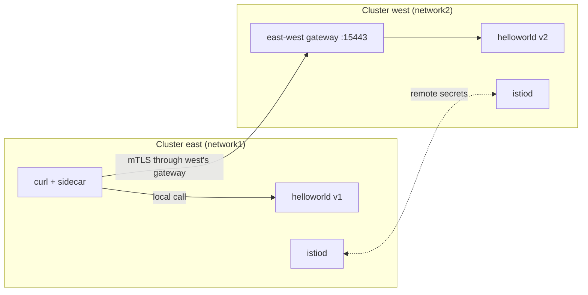

# Lab 04: Multi-cluster, Multi-network

**Goal:** make two clusters on separate networks behave as **one mesh**: a service in one cluster calls a service in
the other, with mTLS, and fails over when its local copy is gone.

Suggested time: 2 to 4 days (the hardest lab: certificates, remote secrets, gateways). Uses its own two Kind clusters,
so it does not need the cluster from lab 00. It does need cloud-provider-kind, `istioctl` and the unpacked Istio
release from [00 Platform](../00-platform/README.md) (steps 2 and 4: `ISTIO_DIR` points at the release folder).

## Concepts

- **Multi-primary:** every cluster runs its **own control plane** (istiod). Each istiod also watches the other
  cluster's API server, so each sees every endpoint. No cluster is a single point of failure.
- **Multi-network:** pods in one cluster cannot reach pods in the other directly. Cross-cluster traffic goes through
  an **east-west gateway** (port 15443) in the target cluster, which passes the mTLS connection through
  (`AUTO_PASSTHROUGH`) to the right Pod.
- **One mesh, one trust:** both clusters share a `meshID` and chain their certificates to the **same root CA**, so a
  workload in `east` trusts a workload in `west`.
- **Service merge:** a Service with the same name and namespace in both clusters is one logical service; its
  endpoints are the union of both clusters.
- **Remote secret:** the credential (a kubeconfig in a Secret) that lets one istiod read the other cluster.



The picture shows east's client. West's client works the same way in the other direction: v2 locally, v1 through east's
east-west gateway. The dotted line is the remote secret each istiod uses to read the other cluster's API server.

## Kind specifics

- Both clusters sit on the `kind` Docker network, but their Pod networks are separate, which is what makes them
  different **networks** for Istio. Different Pod and service subnets (see the `kind-*.yaml` files) make endpoint
  addresses unambiguous.
- cloud-provider-kind (one process) gives both east-west gateways a LoadBalancer address.
- **API server address:** Kind's kubeconfig points at `127.0.0.1:<random port>`, which the other cluster cannot reach.
  The remote secret must use the control-plane container's address on the `kind` network (port 6443).

## Steps

```bash
cd examples/istio-case-studies/04-multicluster-multinetwork
source ../apps/helpers.sh
```

All commands name the cluster with `--context kind-east` or `--context kind-west`.

### 1. Create the two clusters

```bash
kind create cluster --config kind-east.yaml
kind create cluster --config kind-west.yaml
kubectl config get-contexts -o name
```

Add `--image kindest/node:v1.36.4` to use the node image Kubewekend pins. Keep cloud-provider-kind running.

### 2. A shared root CA and an intermediate CA per cluster

```bash
CERTS=$(mktemp -d)
( cd "$CERTS" \
  && make -f "$ISTIO_DIR/tools/certs/Makefile.selfsigned.mk" root-ca \
  && make -f "$ISTIO_DIR/tools/certs/Makefile.selfsigned.mk" east-cacerts \
  && make -f "$ISTIO_DIR/tools/certs/Makefile.selfsigned.mk" west-cacerts )
ls "$CERTS" "$CERTS/east"
```

You get `root-cert.pem` and, per cluster, `ca-cert.pem`, `ca-key.pem`, `cert-chain.pem` and `root-cert.pem`. These keys
are lab material: keep them out of the repository.

### 3. Install Istio in each cluster

Create `istio-system`, label it with its network, give it its CA (the `cacerts` Secret) **before** installing, then
install. `east-istio.yaml` and `west-istio.yaml` differ only in `clusterName` and `network`:

```bash
for c in east west; do
  if [ "$c" = east ]; then NET=network1; else NET=network2; fi
  kubectl --context "kind-$c" create namespace istio-system
  kubectl --context "kind-$c" label namespace istio-system "topology.istio.io/network=$NET"
  kubectl --context "kind-$c" create secret generic cacerts -n istio-system \
    --from-file="$CERTS/$c/ca-cert.pem" --from-file="$CERTS/$c/ca-key.pem" \
    --from-file="$CERTS/$c/root-cert.pem" --from-file="$CERTS/$c/cert-chain.pem"
  istioctl install --context "kind-$c" -f "$c-istio.yaml" --skip-confirmation
done
```

### 4. East-west gateways

The Istio release has a generator for the gateway and a manifest that exposes every service through it:

```bash
"$ISTIO_DIR/samples/multicluster/gen-eastwest-gateway.sh" --network network1 | istioctl --context kind-east install -y -f -
"$ISTIO_DIR/samples/multicluster/gen-eastwest-gateway.sh" --network network2 | istioctl --context kind-west install -y -f -
kubectl --context kind-east apply -n istio-system -f "$ISTIO_DIR/samples/multicluster/expose-services.yaml"
kubectl --context kind-west apply -n istio-system -f "$ISTIO_DIR/samples/multicluster/expose-services.yaml"
kubectl --context kind-east get svc istio-eastwestgateway -n istio-system
kubectl --context kind-west get svc istio-eastwestgateway -n istio-system
```

Each gateway Service gets an `EXTERNAL-IP` from cloud-provider-kind (`172.18.0.4` and `172.18.0.5` in the test run) and
exposes port `15443`. `expose-services.yaml` creates a `cross-network-gateway` that passes TLS for every `*.local`
host through.

### 5. Let each cluster see the other (remote secrets)

```bash
EAST_IP=$(docker inspect east-control-plane | jq -r '.[0].NetworkSettings.Networks.kind.IPAddress')
WEST_IP=$(docker inspect west-control-plane | jq -r '.[0].NetworkSettings.Networks.kind.IPAddress')
istioctl create-remote-secret --context kind-east --name=east --server="https://$EAST_IP:6443" | kubectl apply -f - --context kind-west
istioctl create-remote-secret --context kind-west --name=west --server="https://$WEST_IP:6443" | kubectl apply -f - --context kind-east
istioctl --context kind-east remote-clusters
```

`remote-clusters` lists `east` and `west`, both `synced`.

### 6. Deploy the app: v1 in east, v2 in west

The same Service in both clusters, but a different version behind it in each:

```bash
for c in east west; do kubectl --context "kind-$c" apply -f namespace-sample.yaml -f service-helloworld.yaml; done
KUBE_CONTEXT=kind-east ../apps/deploy.sh sample curl helloworld-v1
KUBE_CONTEXT=kind-west ../apps/deploy.sh sample curl helloworld-v2
sleep 15
```

### 7. Verify: one service, two clusters

```bash
versions sample 20 kind-east
versions sample 20 kind-west
istioctl --context kind-east proxy-config endpoints deploy/curl.sample --cluster "outbound|5000||helloworld.sample.svc.cluster.local"
```

From **either** cluster, calls reach both versions (for example `14 v1 / 6 v2` from east): v1 locally, v2 through the
other cluster's gateway. The endpoints list shows the proof:

```text
ENDPOINT             STATUS      OUTLIER CHECK     CLUSTER
10.10.0.8:5000       HEALTHY     OK                outbound|5000||helloworld.sample.svc.cluster.local
172.18.0.5:15443     HEALTHY     OK                outbound|5000||helloworld.sample.svc.cluster.local
```

A **local Pod IP** (`10.10.0.x`, east's pod subnet) and the **remote cluster's east-west gateway** (`:15443`): east cannot
reach west's Pods, so west's endpoint is its gateway.

## Verify

| Check | Expected |
|-------|----------|
| `istioctl --context kind-east remote-clusters` | `east` and `west`, `synced` |
| `versions sample 20 kind-east` and `kind-west` | Both v1 and v2 appear in each |
| Endpoints of `helloworld` seen from east | One `10.10.x.x:5000` Pod and one `<west gateway IP>:15443` |

## Break it

**1. Locality failover.** Label the nodes with a region and zone, apply a DestinationRule that prefers local endpoints
(`localityLbSetting`, which needs `outlierDetection`), then remove east's copy of the app:

```bash
kubectl --context kind-east label node east-control-plane topology.kubernetes.io/region=east topology.kubernetes.io/zone=east-1 --overwrite
kubectl --context kind-west label node west-control-plane topology.kubernetes.io/region=west topology.kubernetes.io/zone=west-1 --overwrite
for c in east west; do
  kubectl --context "kind-$c" -n sample rollout restart deploy
  kubectl --context "kind-$c" apply -f destinationrule-locality.yaml
done
for c in east west; do kubectl --context "kind-$c" -n sample rollout status deploy; done
sleep 15
versions sample 20 kind-east            # all v1: the local endpoint is preferred
versions sample 20 kind-west            # all v2
kubectl --context kind-east -n sample scale deploy/helloworld-v1 --replicas=0
sleep 15
versions sample 20 kind-east            # all v2: failed over to the other cluster
kubectl --context kind-east -n sample scale deploy/helloworld-v1 --replicas=1
kubectl --context kind-east -n sample rollout status deploy/helloworld-v1
sleep 15
versions sample 20 kind-east            # all v1 again
```

**2. Lose a remote secret.** Remove the locality rule (so traffic spreads again), then delete the secret that lets west
read east:

```bash
for c in east west; do kubectl --context "kind-$c" delete -f destinationrule-locality.yaml; done
sleep 5
versions sample 20 kind-west            # v1 and v2
kubectl --context kind-west -n istio-system delete secret istio-remote-secret-east
sleep 15
istioctl --context kind-west remote-clusters
versions sample 20 kind-west            # only v2: west no longer sees east
```

`remote-clusters` in west now lists only `west`. Restore it, and both versions return:

```bash
istioctl create-remote-secret --context kind-east --name=east --server="https://$EAST_IP:6443" | kubectl apply -f - --context kind-west
sleep 15
versions sample 20 kind-west
```

## Self-check

- How does a request in east find an endpoint in west, and why is the endpoint address a gateway rather than a Pod?
- Why must both clusters share the root CA, and what would you see if they did not?
- What does `outlierDetection` have to do with locality failover?
- What stops working in each direction when one remote secret is missing?

## Cleanup

```bash
kind delete cluster --name east
kind delete cluster --name west
```

Delete the folder with the generated certificates (`rm -r "$CERTS"`). Stop cloud-provider-kind when no Kind cluster
needs it.

> [!NOTE]
>
> This lab uses sidecar mode. Istio also supports ambient multi-cluster (the generator script has an `--ambient`
> flag); check the Istio release notes for its status in your version before building on it.
