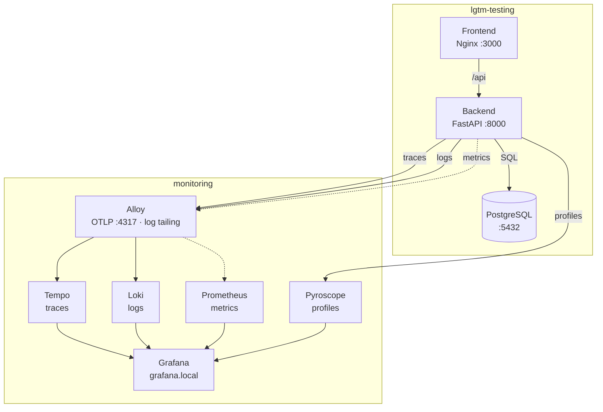

# LGTM Stack Testing Application

A full-stack demo application designed to reproduce and visualize monitoring scenarios using Grafana's **LGTM stack** (Loki, Grafana, Tempo, Mimir/Prometheus) + **Pyroscope** for profiling.

## Architecture



- **Namespaces:** the app runs in `lgtm-testing`; the stack installed by `./scripts/setup.sh <cluster> utils monitoring` runs in `monitoring`.
- **Signals:** the backend (OTel SDK, structlog, Pyroscope SDK) sends **traces** over OTLP gRPC to Alloy, writes JSON **logs** with `trace_id` to stdout (Alloy tails pod logs into Loki), and pushes **profiles** to Pyroscope on `:4040`.
- **Solid arrows** run by default. **Dashed arrows** are optional: custom metrics need `OTEL_METRICS_ENABLED=true` on the backend and the OTLP metrics pipeline in Alloy (`otelcol.exporter.prometheus` / `prometheus.remote_write`, commented out in `ansible/templates/alloy-values.yaml.j2`). Prometheus still gets cluster metrics from kube-prometheus-stack.
- **Correlation in Grafana:** Traces ↔ Logs through the `trace_id` field in every log line; Traces ↔ Profiles through the span links added by the Pyroscope span processor.

## Quick Start

### Option 1: Docker Compose (Local Development)

```bash
cd examples/lgtm-testing

# Start all services
docker compose up -d --build

# Open frontend
open http://localhost:3000

# Or use backend API directly
open http://localhost:8000/docs
```

### Option 2: Kubernetes Deployment

```bash
# Build images (use your registry or local registry)
docker build -t lgtm-testing-backend:latest ./backend
docker build -t lgtm-testing-frontend:latest ./frontend

# Deploy to cluster
kubectl apply -f k8s/namespace.yaml
kubectl apply -f k8s/postgres.yaml
kubectl apply -f k8s/backend.yaml
kubectl apply -f k8s/frontend.yaml

# Wait for readiness
kubectl -n lgtm-testing wait --for=condition=ready pod -l app.kubernetes.io/part-of=lgtm-testing --timeout=120s
```

### Seed Test Data

```bash
# Via UI: Click "Seed Test Data" button
# Via API:
curl -X POST http://localhost:8000/api/seed/
```

This creates:

| User | Password | Status |
|------|----------|--------|
| alice | password123 | Active |
| bob | password456 | Active |
| charlie | password789 | **LOCKED** |

Plus ~20-60 orders and 10 todos per active user.

---

## Test Scenarios

### 1. Normal Usage (Traces)

**Goal**: Visualize clean request → DB → response trace waterfall in Tempo.

```bash
# Create a todo
curl -X POST http://localhost:8000/api/todos/?owner_id=1 \
  -H "Content-Type: application/json" \
  -d '{"title": "Buy groceries", "description": "Milk, eggs, bread"}'

# List todos
curl http://localhost:8000/api/todos/?owner_id=1

# Update a todo
curl -X PUT http://localhost:8000/api/todos/1 \
  -H "Content-Type: application/json" \
  -d '{"completed": true}'
```

**What to see in Grafana**:
- **Tempo**: Clean span waterfall: `todos.create` → `db.query.todos.insert`
- **Loki**: Logs with `trace_id` field for correlation
- **Prometheus**: `http_requests_total`, `db_operations_total` counters increment

---

### 2. Authentication Errors (Log → Trace → Profile correlation)

**Goal**: Generate auth failures that create error spans, structured error logs with trace_id, and profile data.

```bash
# Successful login
curl -X POST http://localhost:8000/api/auth/login \
  -H "Content-Type: application/json" \
  -d '{"username": "alice", "password": "password123"}'

# Wrong password (401) - creates error span with "invalid_password" event
curl -X POST http://localhost:8000/api/auth/login \
  -H "Content-Type: application/json" \
  -d '{"username": "alice", "password": "WRONG"}'

# Non-existent user (401) - creates error span with "user_not_found" event
curl -X POST http://localhost:8000/api/auth/login \
  -H "Content-Type: application/json" \
  -d '{"username": "nonexistent", "password": "whatever"}'

# Locked account (403) - creates error span with "account_locked" event
curl -X POST http://localhost:8000/api/auth/login \
  -H "Content-Type: application/json" \
  -d '{"username": "charlie", "password": "password789"}'
```

**What to see in Grafana**:
- **Tempo**: Error spans (red) with span events showing failure reason
- **Loki**: `login_failed_*` log entries with `trace_id` - click to jump to trace
- **Prometheus**: `auth_attempts_total{status="invalid_password"}` counter
- **Pyroscope**: BCrypt password hashing visible in flamegraph during auth operations

---

### 3. Bottleneck Performance (Profiling + Tracing)

**Goal**: Create slow operations visible as long spans in Tempo and hotspots in Pyroscope flamegraphs.

```bash
# a) Slow Report - N+1 Query Problem
# Creates many small DB spans instead of one batch query
curl http://localhost:8000/api/bottleneck/slow-report?user_id=1

# b) Slow Cascade - Chained slow operations
# 4 sequential operations: slow query → computation → aggregate → external call
curl http://localhost:8000/api/bottleneck/slow-cascade

# c) CPU Intensive - Hash computation
# Heavy CPU work visible in Pyroscope flamegraph
curl "http://localhost:8000/api/bottleneck/cpu-intensive?iterations=500000"
```

**What to see in Grafana**:
- **Tempo (slow-report)**: Many small `db.query.orders.get_*` spans (N+1 pattern) - should have been 1 query
- **Tempo (slow-cascade)**: Waterfall showing 4 cascading steps with time breakdown
- **Pyroscope (cpu-intensive)**: Flamegraph showing `hashlib.sha256` and `_fibonacci` hotspots
- **Loki**: Warning logs with `duration_ms` for slow operations
- **Prometheus**: `db_query_duration_seconds` histogram shows slow query distribution

---

## Custom Metrics Reference

| Metric | Type | Description | Labels |
|--------|------|-------------|--------|
| `http_requests_total` | Counter | Total HTTP requests | method, endpoint, status |
| `auth_attempts_total` | Counter | Authentication attempts | status, username |
| `db_operations_total` | Counter | Database operations | operation, table |
| `app_errors_total` | Counter | Application errors | error_type, endpoint |
| `http_request_duration_seconds` | Histogram | Request latency distribution | endpoint, method, status |
| `db_query_duration_seconds` | Histogram | DB query latency | operation, table |
| `order_processing_duration_seconds` | Histogram | Order processing time | product |
| `active_connections` | UpDownCounter | Current active HTTP connections | - |
| `active_db_sessions` | UpDownCounter | Current active DB sessions | - |

### Metric Type Concepts

- **Counter**: Monotonically increasing (only goes up). Use for: total requests, errors, events. Query with `rate()` or `increase()`.
- **Histogram**: Distribution of values in buckets. Use for: latency, sizes. Query with `histogram_quantile()` for p50/p95/p99.
- **UpDownCounter**: Can increase and decrease. Use for: active connections, queue size. Shows current state.

---

## Grafana Exploration Guide

### Trace → Log Correlation
1. Go to **Grafana → Explore → Tempo**
2. Search for traces with service `lgtm-testing-api`
3. Find an error trace (red span)
4. Click on a span → "Logs for this span" → jumps to Loki with `trace_id` filter

### Log → Trace Correlation
1. Go to **Grafana → Explore → Loki**
2. Query: `{app="lgtm-testing-api"} | json | level="error"`
3. Expand a log line → click `trace_id` value → jumps to Tempo

### Profiling Analysis
1. Go to **Grafana → Explore → Pyroscope**
2. Select app: `lgtm-testing-api`
3. Run the CPU-intensive endpoint
4. View flamegraph → look for `hashlib.sha256` and `_fibonacci` functions

### Dashboard Queries

```promql
# Request rate by endpoint
rate(http_requests_total{service_name="lgtm-testing-api"}[5m])

# Error rate
rate(app_errors_total{service_name="lgtm-testing-api"}[5m])

# P95 request latency
histogram_quantile(0.95, rate(http_request_duration_seconds_bucket{service_name="lgtm-testing-api"}[5m]))

# Auth failure rate
rate(auth_attempts_total{status!="success"}[5m])

# Slow queries (P99 DB latency)
histogram_quantile(0.99, rate(db_query_duration_seconds_bucket[5m]))

# Active connections
active_connections{service_name="lgtm-testing-api"}
```

---

## Data Flow

```
Application Code
    │
    ├── Structured Logs (structlog + JSON)
    │   └── Contains: trace_id, span_id, level, message, custom fields
    │       └── stdout → Alloy (pod log collection) → Loki
    │
    ├── Traces (OpenTelemetry SDK)
    │   └── Contains: spans, events, attributes, status
    │       └── OTLP gRPC :4317 → Alloy → Tempo
    │
    ├── Metrics (OpenTelemetry SDK)
    │   └── Contains: counters, histograms, up-down-counters
    │       └── OTLP gRPC :4317 → Alloy → Prometheus
    │
    └── Profiles (Pyroscope agent)
        └── Contains: CPU flamegraphs, memory allocation
            └── Direct push → Pyroscope :4040
```

## Project Structure

```
examples/lgtm-testing/
├── backend/
│   ├── Dockerfile
│   ├── requirements.txt
│   └── app/
│       ├── main.py              # FastAPI app with LGTM lifecycle
│       ├── config.py            # Environment-based settings
│       ├── database.py          # SQLAlchemy engine & session
│       ├── models.py            # User, Todo, Order models
│       ├── schemas.py           # Pydantic request/response models
│       ├── telemetry.py         # OpenTelemetry setup (traces + metrics)
│       ├── logging_config.py    # Structlog with trace context injection
│       ├── metrics.py           # Custom Prometheus metrics definitions
│       └── routes/
│           ├── health.py        # Health/readiness probes
│           ├── auth.py          # Auth error scenarios
│           ├── todos.py         # Normal CRUD operations
│           ├── bottleneck.py    # Performance bottleneck scenarios
│           └── seed.py          # Test data seeding
├── frontend/
│   ├── Dockerfile
│   ├── index.html               # Testing dashboard UI
│   └── nginx.conf               # Nginx reverse proxy config
├── k8s/
│   ├── namespace.yaml
│   ├── postgres.yaml
│   ├── backend.yaml
│   └── frontend.yaml
├── docker-compose.yaml           # Local development
├── docker-compose.k8s.yaml       # K8s overlay
├── .env.example
└── README.md
```
